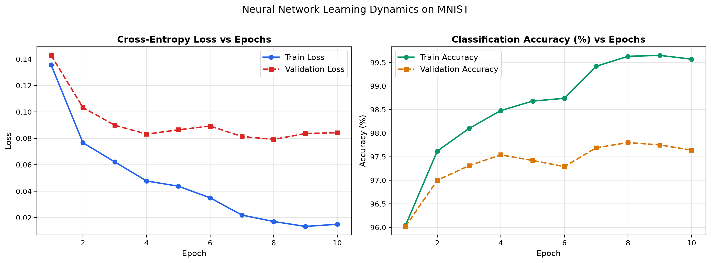
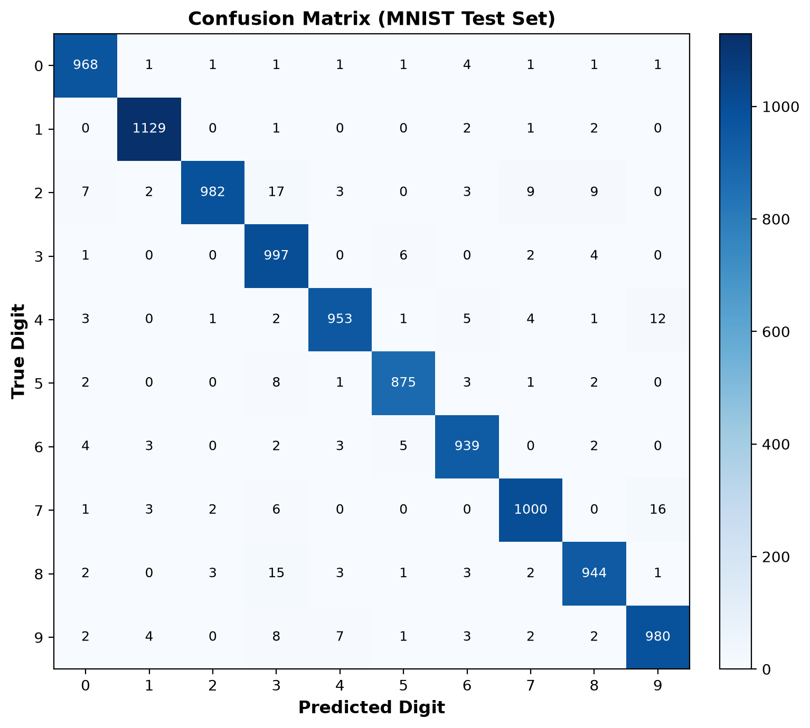
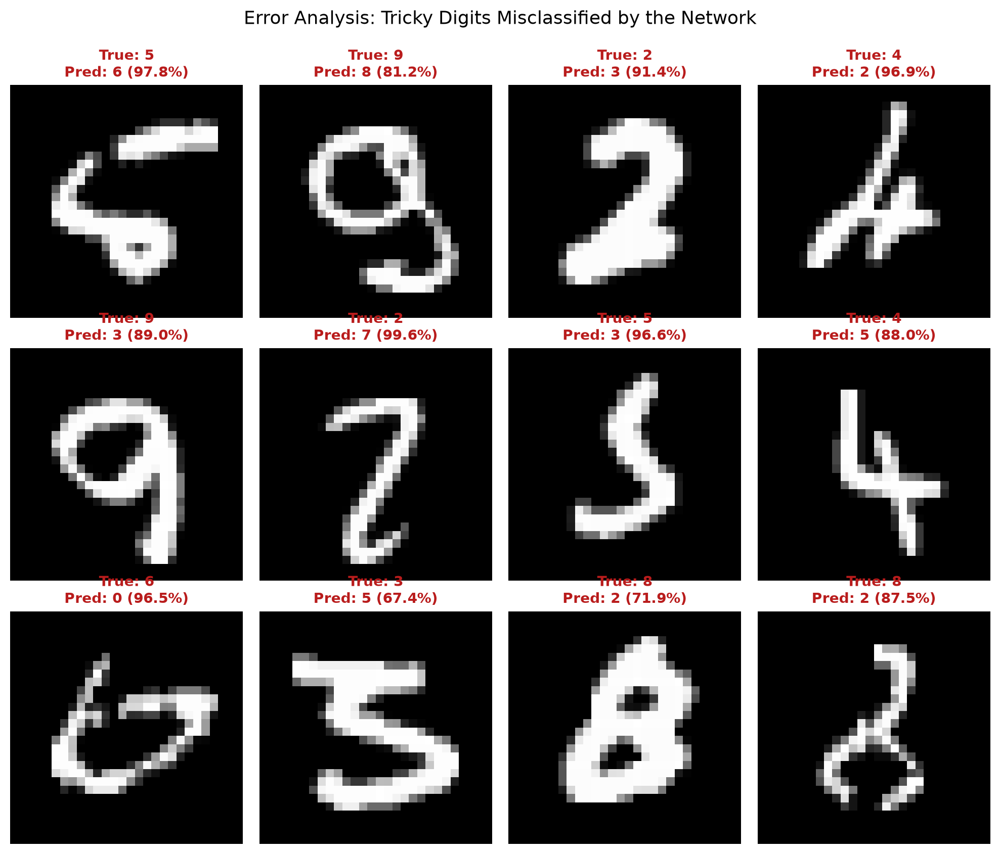

# Chapter 1: Building Your First Neural Network (MNIST from Scratch)

[](https://www.python.org/)
[](https://opensource.org/licenses/MIT)
[](https://numpy.org/)
[]()

> Welcome to **Chapter 1**! In this chapter, we build an artificial neural network from scratch in pure **NumPy** to recognize handwritten digits ($0$ through $9$) from the famous **MNIST dataset**.
> 
> No high-level libraries like PyTorch `nn.Module` or TensorFlow are used for the model logic. Every forward pass, activation function, loss equation, and backward pass gradient is coded by hand so you can see exactly how a machine learns.

---

## 1. The Big Picture: What Are We Doing?

Imagine you are looking at a messy handwritten digit scribbled on a piece of paper. Your eyes capture the strokes, your brain processes the patterns, and you instantly say: *"That's a 7."*

How can a computer do that?
A computer does not have eyes; it only understands numbers. In this chapter, we will:
1. Turn an image of a handwritten digit into a list of numbers (**pixels**).
2. Pass those numbers through layers of mathematical calculation units called **artificial neurons**.
3. Measure how wrong the network's initial random guesses are using a **loss function**.
4. Use calculus (**backpropagation**) to tweak the internal dials (**weights**) until the network guesses correctly **~98% of the time**.

---

## 2. Basic Terms & Concepts Explained Simply

Before looking at the code, let's break down the essential deep learning vocabulary in plain English.

### A. The Dataset
* **MNIST**: Stands for *Modified National Institute of Standards and Technology*. It is the historic "Hello World" benchmark of computer vision — a collection of $70,000$ small grayscale images of handwritten digits from $0$ to $9$.
* **Pixel**: Short for "picture element". Each image is $28$ pixels tall and $28$ pixels wide ($28 \times 28 = 784$ pixels in total). To a computer, a pixel is just a number from `0` (black background) to `255` (bright white ink).
* **Normalization**: Computers learn much better when numbers are small and standardized. We divide every pixel by `255.0` so all inputs range between `0.0` and `1.0`.
* **Flattening**: Our first layer expects a single row of numbers. We flatten the 2D grid of $28 \times 28$ pixels into a single 1D vector of $784$ numbers.


---

### B. The Three Splits (Why Three?)
We divide our 70,000 images into three separate piles:
1. **Training Set ($50,000$ images)**: The textbook pages the network reads to learn and adjust its internal weights.
2. **Validation Set ($10,000$ images)**: Practice quizzes taken after every round of training. The network is *not* trained on these images; we use them to monitor if the network is genuinely learning or just memorizing.
3. **Test Set ($10,000$ images)**: The final exam. Strictly locked in a vault and only evaluated once after training is completely done to measure true real-world performance.

---

### C. The Artificial Neuron
An artificial neuron is inspired by biological brain cells:

```
Inputs (Pixels)       Weights (Dials)
   x₁  ─────────────► (w₁) ─────┐
   x₂  ─────────────► (w₂) ─────┼──► [ Sum: z = w·x + b ] ──► [ Activation: ReLU ] ──► Output (a)
  ...                           │           ▲
   x₇₈₄ ────────────► (w₇₈₄) ───┘           │
                                         Bias (b)
```

* **Inputs ($x$)**: The incoming signals (e.g. the brightness of each pixel).
* **Weights ($w$)**: The "importance dials". If a certain pixel in the center is bright whenever the digit is a `1`, the connection weight to the `1` neuron becomes large and positive.
* **Bias ($b$)**: The neuron's baseline offset. It controls how easily the neuron fires, even if all inputs are zero.
* **Weighted Sum ($z$)**: Multiplying every input by its corresponding weight and adding the bias:
  $$z = (x_1 w_1 + x_2 w_2 + \dots + x_{784} w_{784}) + b$$

---

### D. Activation Functions (Why Do We Need Them?)
If all we do is calculate $z = w \cdot x + b$, we are just adding straight lines together. Stacking 100 linear layers together still only produces a straight line!
To learn curved shapes, loops, and complex patterns, we must introduce **non-linearity** via **activation functions**:

#### 1. ReLU (Rectified Linear Unit) — Used in Hidden Layers
* **What it does**: If the number is negative, turn it to zero. If positive, keep it as is!
* **Equation**: $\text{ReLU}(z) = \max(0, z)$
* **Why we use it**: It is lightning-fast to compute and prevents the network's signals from fading away during training (the vanishing gradient problem).

#### 2. Softmax — Used in the Final Output Layer
* **What it does**: Takes the 10 raw scores from our output neurons (which can be negative or positive) and converts them into **probabilities** that sum up to $1.0$ ($100\%$).
* **Equation**:
  $$\text{Softmax}(z_i) = \frac{e^{z_i}}{\sum_{j=1}^{10} e^{z_j}}$$
* **Why we use it**: It lets us say: *"The network is 96% sure this image is an 8, 3% sure it is a 3, and 1% sure it is a 0."*

---

### E. How Learning Works (The Training Loop)

1. **Forward Pass**: Feeding the pixels through the network to generate output probabilities.
2. **Loss Function (Categorical Cross-Entropy)**:
   * Measures how disappointed we are with the network's guess.
   * If the true label is `4` and the network gave `4` a 99% probability, loss is almost `0.0`.
   * If the network gave `4` only a 1% probability, the loss is very high!
3. **Backward Pass (Backpropagation)**:
   * The "blame game". Using the calculus chain rule, we compute how much each individual weight and bias in the network contributed to the loss.
4. **Gradient ($\nabla$)**: A vector indicating the direction that makes the error *worse*. Therefore, we step in the **opposite direction** to reduce error.
5. **Learning Rate ($\alpha$)**: How big of a step we take down the loss hill.
   * If too high, we overshoot the minimum and the network explodes.
   * If too low, training takes days.
6. **Epoch**: One complete pass through all $50,000$ training images.
7. **Batch & Mini-batch**: Instead of updating weights after all 50,000 images (too slow) or after every single image (too noisy), we group images into chunks of $64$ called **mini-batches**.
8. **Momentum**: Like a heavy ball rolling downhill — it accumulates speed in consistent directions and ignores tiny bumps.

---

### F. Diagnostic Terms

* **Overfitting**: When the network simply memorizes the training pictures (like a student memorizing quiz answers without understanding the concept). It gets 99% on the training set, but drops to 70% on new images.
* **Generalization**: When the network performs equally well on images it has never seen before.
* **Confusion Matrix**: A $10 \times 10$ table showing the true digit on one axis and the predicted digit on the other. It reveals exactly which digits fool the network most often (e.g. `4` vs `9`).

---

## 3. Our Network Architecture

We construct a **2-Layer Multi-Layer Perceptron (MLP)**:

```
INPUT LAYER               HIDDEN LAYER                OUTPUT LAYER
(784 Pixels)              (128 Neurons)               (10 Classes)

  [Pixel 1]   ──┐
  [Pixel 2]   ──┼───►  [ 128 Neurons ]  ───►  [ 10 Probabilities ]
     ...      ──┤         (with ReLU)               (with Softmax)
  [Pixel 784] ──┘
```

- **Parameters**:
  - $W_1$ (Weights Layer 1): $784 \times 128 = 100,352$
  - $b_1$ (Biases Layer 1): $128$
  - $W_2$ (Weights Layer 2): $128 \times 10 = 1,280$
  - $b_2$ (Biases Layer 2): $10$
  - **Total Trainable Knobs**: **$101,770$**

---

## 4. Training Results & Visual Analysis

When you run `python train.py`, the network trains on all $50,000$ images in just **~2.3 seconds** on a standard laptop.

### Learning Dynamics: Loss & Accuracy Over 10 Epochs



Notice how:
1. **Loss drops exponentially** in the first 3 epochs as the network grasps basic strokes and loops.
2. **Validation accuracy** tracks **Training accuracy** closely (reaching **97.6%**), showing zero harmful overfitting!

---

### Test Evaluation: The Final Exam

On the $10,000$ unseen test images:
- **Test Accuracy**: **97.67%**
- **Test Loss**: **0.0831**
- **Total Errors**: Only $233$ mistakes out of $10,000$ images ($2.33\%$ error rate).

---

### Confusion Matrix



The strong dark diagonal confirms high accuracy across all digits ($0$ through $9$). The off-diagonal numbers show rare confusions (e.g., a few `4`s mistaken for `9`s, or `7`s mistaken for `2`s).

---

### Sample Predictions

Green titles indicate correct predictions; red indicates a mistake:


---

### Error Analysis: Why Did Mistakes Happen?

Inspecting the images the network got wrong gives deep insight into computer vision:



**Key Takeaways from Errors**:
1. **Ambiguous Handwriting**: Many of these digits have incomplete loops or extreme slants. Human readers would disagree on several of them!
2. **Translation Sensitivity**: Fully connected dense layers treat every pixel as an isolated feature. If a digit is drawn slightly off-center, a dense layer sees it as an entirely different pattern. *(In future chapters, we will solve this using Convolutional Neural Networks - CNNs!)*

---

## 5. How to Run the Code Yourself

### Step 1: Clone the Repository
```bash
git clone https://github.com/Soorya-Narayan/Neural-networks-from-scratch.git
cd Neural-networks-from-scratch
```

### Step 2: Set Up Virtual Environment & Dependencies
```bash
python3 -m venv .venv
source .venv/bin/activate
pip install -e ".[dev]"
```

### Step 3: Run the Training Pipeline
```bash
python train.py
```
This single command downloads MNIST, trains the network for 10 epochs, validates it, evaluates on the test set, and generates all 5 charts in `plots/`.

### Step 4: Run the Verification Tests
To verify the math (including finite-difference numerical gradient checks):
```bash
pytest
```

### Step 5: Launch the Interactive Notebook
To play with the code cell-by-cell in your browser:
```bash
jupyter lab notebook.ipynb
```

---

## Repository Structure

```text
├── data/                       # Local cache for downloaded MNIST dataset (.gz)
├── plots/                      # Generated visualization charts
│   ├── sample_digits.png       # Raw sample digit images
│   ├── loss_accuracy_curves.png# Training and validation progress
│   ├── confusion_matrix.png    # Digit-by-digit confusion heatmap
│   ├── test_predictions.png    # Sample test predictions (green/red)
│   └── misclassified_examples.png # Tricky digits analysis
├── src/                        # Clean from-scratch neural network implementation
│   ├── __init__.py
│   ├── dataset.py              # Download, parse, normalize, batch loader
│   ├── model.py                # NeuralNetwork, ReLU, Softmax, Backprop
│   └── visualize.py            # Matplotlib plotting scripts
├── tests/
│   └── test_model.py           # Numerical gradient checks & shape tests
├── notebook.ipynb              # Interactive step-by-step Jupyter notebook
├── train.py                    # Complete end-to-end runnable script
├── pyproject.toml              # Project dependencies and packaging
└── README.md                   # Chapter 1 complete textbook guide
```

---

## License

This project is licensed under the [MIT License](LICENSE).
