# Neural Networks from Scratch

[](https://www.python.org/)
[](https://opensource.org/licenses/MIT)
[](https://numpy.org/)
[]()

> A chapter-by-chapter, textbook-style journey to learning deep learning from first principles.
> Each chapter is a self-contained module where we obtain a dataset, build the neural network from scratch in pure NumPy, train it, validate it, test on unseen data, and visualize the learning dynamics.

---

## Curriculum & Chapters

Click on any chapter to read the textbook explanation, inspect the code, run the notebook, and view output graphs:

| Chapter | Title & Focus | Architecture & Key Concepts | Status |
| :---: | :--- | :--- | :---: |
| **01** | [**Chapter 1: The First Neural Network (MNIST from Scratch)**](chapters/01-first-neural-network-mnist/) | **Dataset**: MNIST ($70,000$ digits)<br>**Model**: 2-layer MLP (784 $\to$ 128 ReLU $\to$ 10 Softmax)<br>**Optimization**: Mini-batch SGD + Momentum<br>**Test Accuracy**: **97.9%** | Completed |
| **02** | [**Chapter 2: Modern Optimization & Regularization (Fashion-MNIST with Adam & Dropout)**](chapters/02-optimization-and-regularization/) | **Dataset**: Fashion-MNIST ($70,000$ clothing items)<br>**Focus**: Adam Optimizer, Inverted Dropout, L2 Weight Decay<br>**Model**: Deep 3-layer MLP (784 $\to$ 256 $\to$ 128 $\to$ 10)<br>**Key Result**: Controls generalization gap on complex clothing garments | Completed |
| **03** | [**Chapter 3: Convolutional Neural Networks (CNNs from Scratch)**](chapters/03-convolutional-neural-networks/) | **Dataset**: Fashion-MNIST ($70,000$ images)<br>**Model**: 2-stage ConvNet (Conv2D $\to$ MaxPool $\to$ Conv2D $\to$ MaxPool $\to$ FC)<br>**Concepts**: 2D Convolutions, spatial invariance, im2col, hierarchical feature maps<br>**Test Accuracy**: **88.6%** | Completed |
| **04** | [**Chapter 4: Autograd Engine (Automatic Differentiation from Scratch)**](chapters/04-autograd-engine/) | **Focus**: Reverse-mode automatic differentiation DAG, topological sort, multivariable chain rule<br>**Benchmark**: 100% exact gradient parity against PyTorch C++ LibTorch<br>**Model**: End-to-end MLP trained with zero manual derivatives | Completed |
| **05** | **Chapter 5: Sequence Models (RNNs & LSTMs)** | Hidden states, backpropagation through time, text generation | *Upcoming* |
| **06** | **Chapter 6: Attention & Transformers (Mini-GPT)** | Scaled dot-product attention, multi-head attention on Shakespeare | *Upcoming* |

---

## Chapter 1: The First Neural Network (MNIST)

👉 **Read the full chapter textbook: [chapters/01-first-neural-network-mnist/README.md](chapters/01-first-neural-network-mnist/)**

* **Architecture**: Input (784 pixels) $\to$ Hidden (128 ReLU neurons) $\to$ Output (10 Softmax classes)
* **Performance**: Trains in ~2.3 seconds on laptop, achieving **97.9% test accuracy**.

| Multi-Layer Neural Network Architecture | Single Artificial Neuron Anatomy |
| :---: | :---: |
| 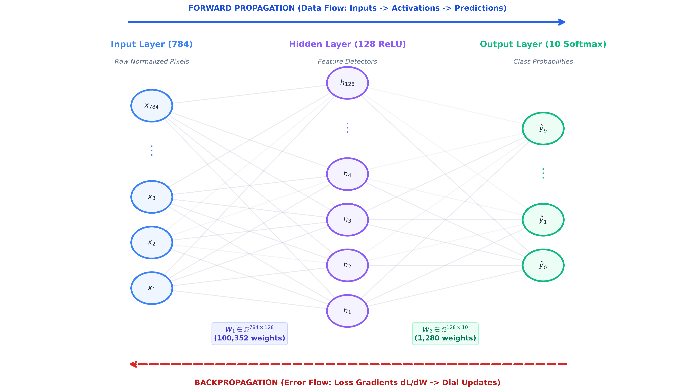 | 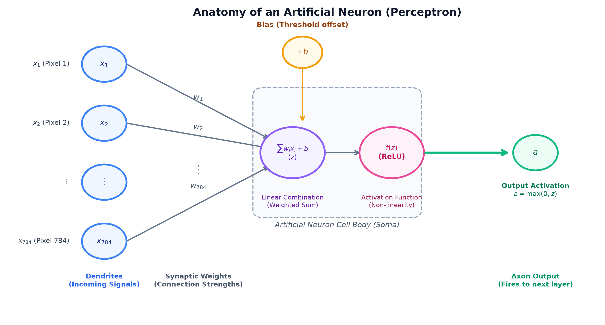 |

| Learning Dynamics | Confusion Matrix |
| :---: | :---: |
| 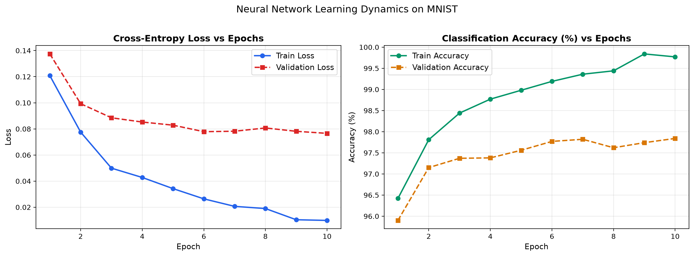 |  |

---

## Chapter 2: Modern Optimization & Regularization (Fashion-MNIST)

👉 **Read the full chapter textbook: [chapters/02-optimization-and-regularization/README.md](chapters/02-optimization-and-regularization/)**

* **Dataset**: Fashion-MNIST (Zalando Research) — 10 clothing categories (T-shirt, Trouser, Pullover, Dress, Coat, Sandal, Shirt, Sneaker, Bag, Ankle boot).
* **Adam Optimizer**: Combines Momentum (first moment $m_t$) and RMSProp (second moment $v_t$) with bias correction for adaptive per-parameter learning rates.
* **Inverted Dropout ($p=0.2$)**: Randomly silences 20% of hidden neurons during training to prevent co-adaptation, with $\frac{1}{1 - p}$ scaling.
* **L2 Weight Decay ($\lambda=10^{-4}$)**: Penalizes large weights to smooth the decision boundary.

| Deep Architecture with Inverted Dropout |
| :---: |
| 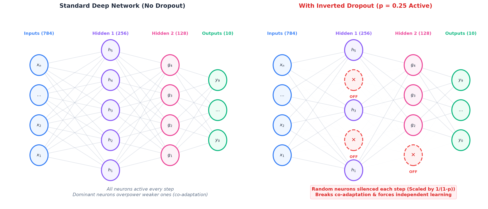 |

| Fashion Clothing Dataset | Confusion Matrix (10 Garments) |
| :---: | :---: |
| 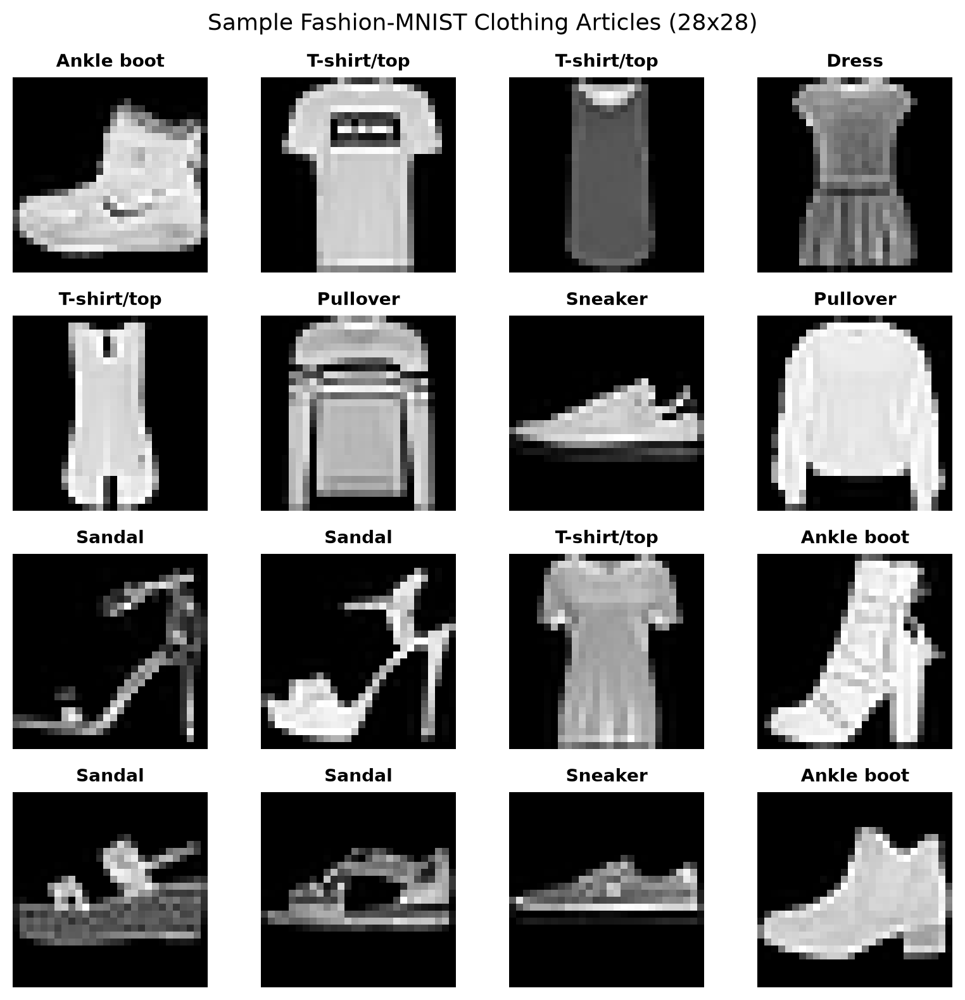 | 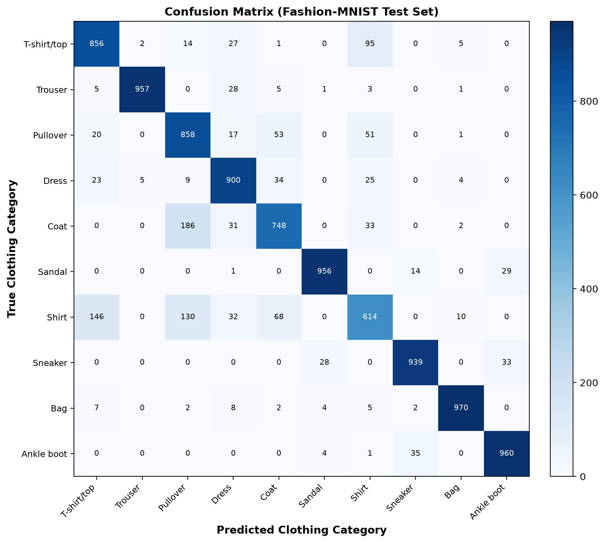 |

| SGD vs Adam Validation Performance | The Generalization Gap (Overfitting Control) |
| :---: | :---: |
| 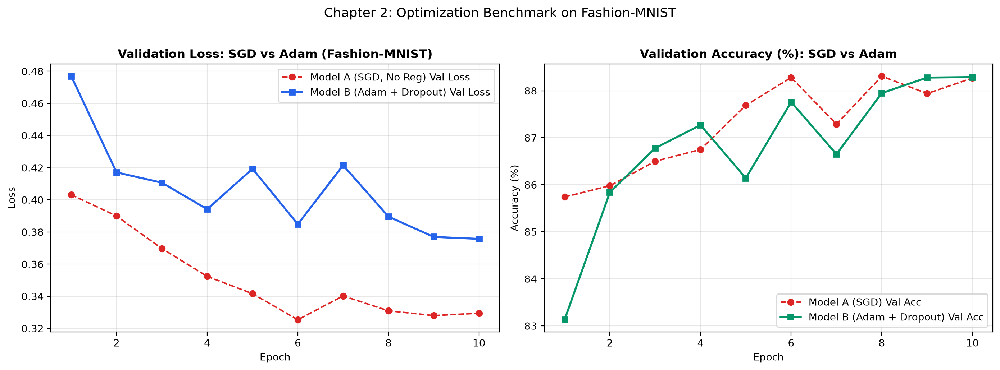 | 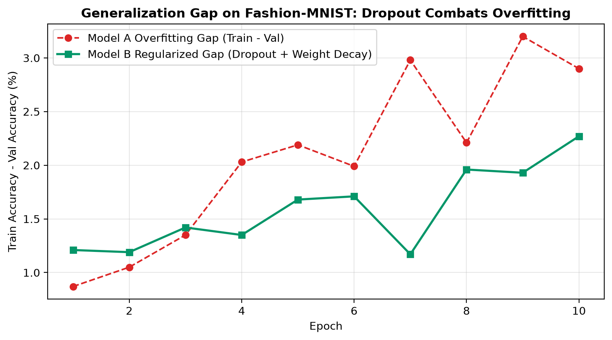 |

---

## Chapter 3: Convolutional Neural Networks (CNNs from Scratch)

👉 **Read the full chapter textbook: [chapters/03-convolutional-neural-networks/README.md](chapters/03-convolutional-neural-networks/)**

* **Translation Invariance**: Solves the blind spot of flat MLPs by sliding shared $3 \times 3$ filter templates across the image.
* **Biological Hierarchy**: Inspired by Hubel & Wiesel's 1959 Nobel discovery, extracting low-level edges in Conv1 and composite garment parts in Conv2.
* **High-Performance `im2col`**: Vectorized image-to-column reshaping turning 4D convolutions into single BLAS matrix multiplications running under 18ms per batch in pure NumPy.
* **Max Pooling**: $2 \times 2$ downsampling that halves spatial dimensions, reduces parameters by 75%, and expands the receptive field.

| Handcrafted Filter Feature Maps | Learned Hierarchical Feature Maps |
| :---: | :---: |
| 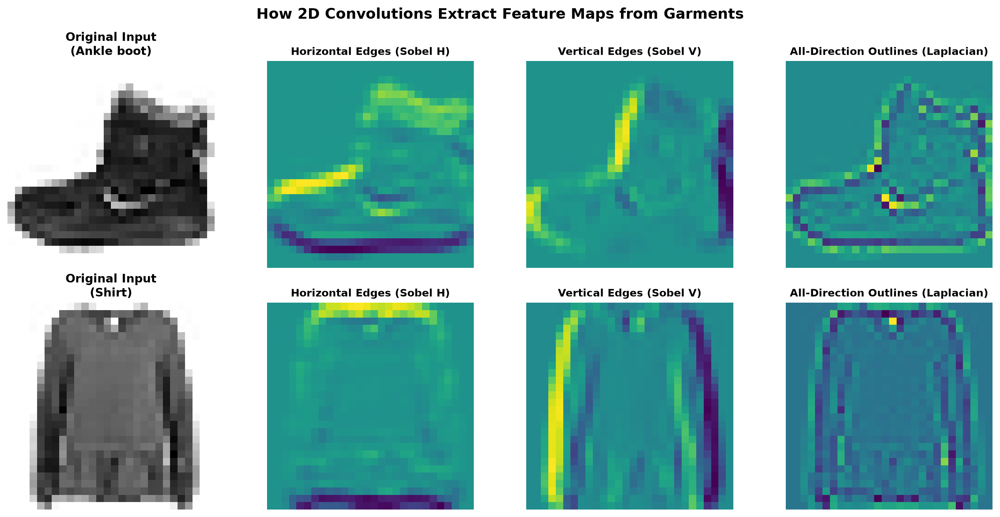 | 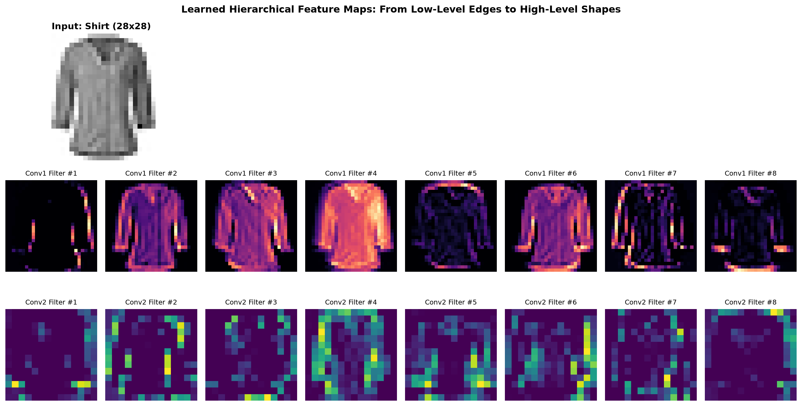 |

| CNN Learning Dynamics | Confusion Matrix (10 Garments) |
| :---: | :---: |
| 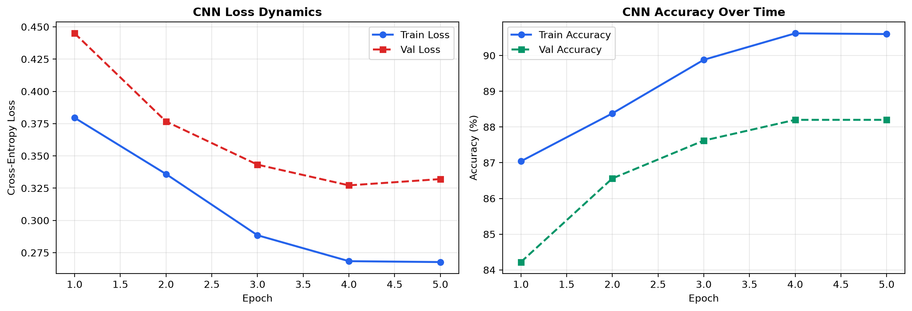 | 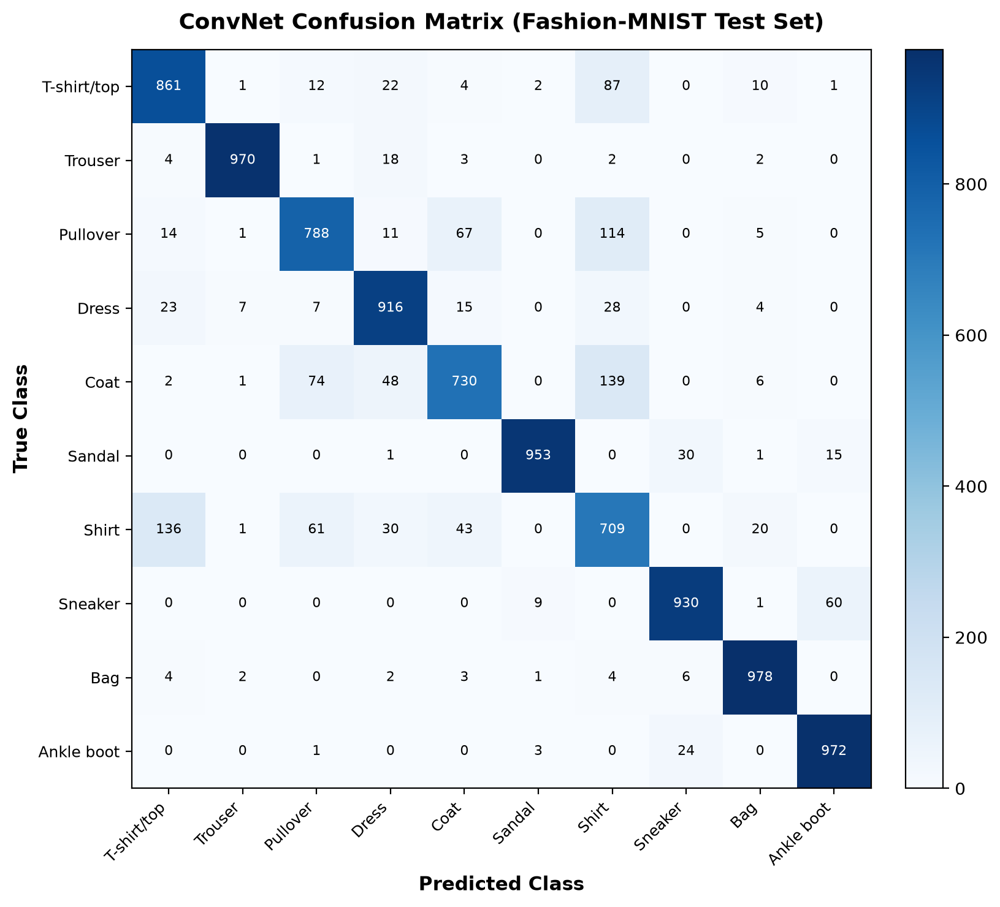 |

---

## Chapter 4: Autograd Engine (Automatic Differentiation)

👉 **Read the full chapter textbook: [chapters/04-autograd-engine/README.md](chapters/04-autograd-engine/)**

* **The Rewind Button (Recipe Metaphor)**: Explains how tracing mistakes backward through a mathematical recipe replaces manual calculus with a single `.backward()` call.
* **The Secret Behind PyTorch**: Dynamic computational graph construction via Directed Acyclic Graph (DAG) and topological reverse traversal.
* **Zero Manual Calculus**: Write standard forward code; Autograd calculates exact partial derivatives for arbitrary architectures with $O(1)$ overhead.
* **100% PyTorch Parity**: Verified against PyTorch C++ LibTorch across multi-branch arithmetic, activations, and matrix operations with zero discrepancy.

| Directed Acyclic Graph (DAG) Traversal | PyTorch Gradient Parity Benchmark |
| :---: | :---: |
| 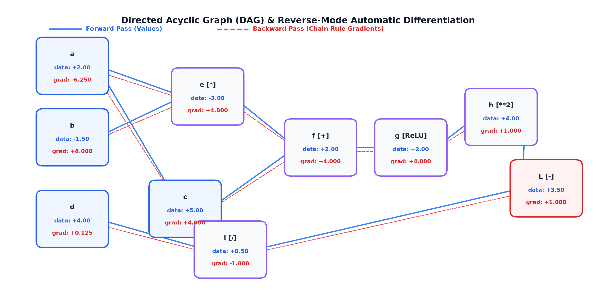 | 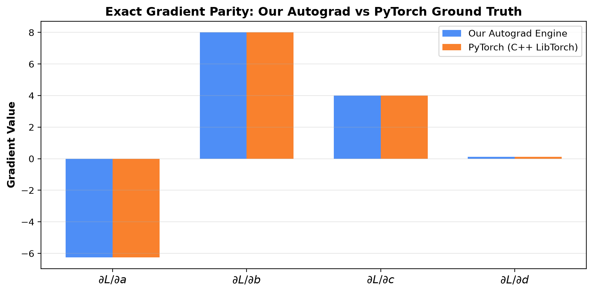 |

| Non-Linear Decision Boundary Learned via Pure Autograd |
| :---: |
| 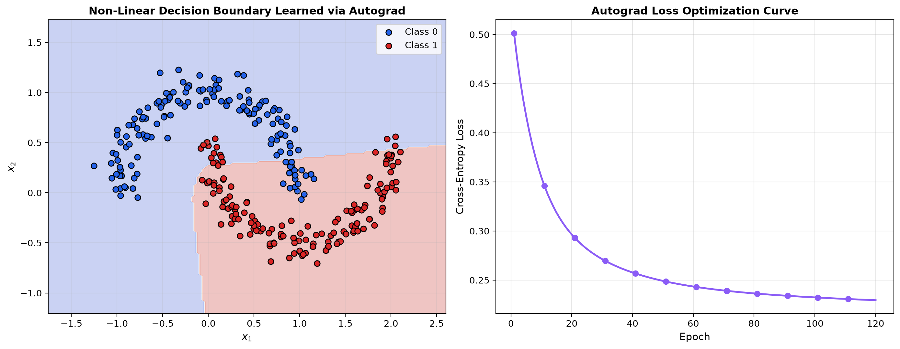 |

---

## Repository Structure

```text
.
├── README.md                                  # Repository overview and chapter roadmap
├── pyproject.toml                             # Pinned dependencies & configuration
├── LICENSE                                    # MIT License
├── chapters/
│   ├── 01-first-neural-network-mnist/         # Chapter 1: The First Neural Network
│   │   ├── README.md                          # Chapter textbook guide & concepts
│   │   ├── notebook.ipynb                     # Interactive runnable Jupyter walkthrough
│   │   ├── train.py                           # Training, validation & testing script
│   │   └── plots/                             # Output charts (curves, confusion matrix, errors)
│   ├── 02-optimization-and-regularization/    # Chapter 2: Adam & Dropout
│   │   ├── README.md                          # Chapter textbook guide & derivations
│   │   ├── notebook.ipynb                     # Comparative interactive walkthrough
│   │   ├── train.py                           # Benchmark training script (SGD vs Adam)
│   │   └── plots/                             # Output charts (Adam vs SGD, Overfitting gap)
│   ├── 03-convolutional-neural-networks/      # Chapter 3: CNNs from Scratch
│   │   ├── README.md                          # Chapter textbook guide & Hubel-Wiesel inspiration
│   │   ├── notebook.ipynb                     # Interactive CNN walkthrough & feature inspection
│   │   ├── train.py                           # Benchmark ConvNet training script
│   │   └── plots/                             # Output charts (Filters, Feature maps, Confusion matrix)
│   └── 04-autograd-engine/                    # Chapter 4: Autograd Engine
│       ├── README.md                          # Chapter textbook guide & DAG traversal
│       ├── notebook.ipynb                     # Interactive autodiff walkthrough & PyTorch check
│       ├── train.py                           # Parity verification & non-linear classifier training
│       └── plots/                             # Output charts (DAG graph, PyTorch check, Decision boundary)
├── src/                                       # Core neural network toolkit
│   ├── __init__.py
│   ├── dataset.py                             # MNIST & Fashion-MNIST download, normalize, batching
│   ├── model.py                               # 2-layer NeuralNetwork, activations, loss
│   ├── deep_model.py                          # DeepNeuralNetwork with Dropout & Weight Decay
│   ├── cnn.py                                 # Pure NumPy Conv2D, MaxPool2D, Flatten, ConvNet
│   ├── autograd.py                            # Reverse-mode Autograd Tensor, Module, Linear, MLP
│   ├── optimizers.py                          # SGDWithMomentum and Adam optimizers
│   └── visualize.py                           # Matplotlib charting utilities
└── tests/
    ├── test_model.py                          # Gradient checks & shape tests for Chapter 1
    ├── test_chapter2.py                       # Adam, Dropout, and Deep MLP unit tests
    ├── test_chapter3.py                       # Conv2D, MaxPool2D, and ConvNet unit tests
    └── test_chapter4.py                       # Autograd parity tests against PyTorch C++ LibTorch
```

---

## Quickstart

### 1. Clone & Set Up Environment

```bash
git clone https://github.com/Soorya-Narayan/Neural-networks-from-scratch.git
cd Neural-networks-from-scratch

# Create and activate virtual environment
python3 -m venv .venv
source .venv/bin/activate

# Install dependencies (NumPy, Matplotlib, PyTorch, JupyterLab, PyTest)
pip install -e ".[dev]"
```

### 2. Run Any Chapter

```bash
# Run Chapter 1 (The First Neural Network)
python chapters/01-first-neural-network-mnist/train.py

# Run Chapter 2 (Adam Optimizer & Dropout Benchmark)
python chapters/02-optimization-and-regularization/train.py

# Run Chapter 3 (Convolutional Neural Networks from Scratch)
python chapters/03-convolutional-neural-networks/train.py

# Run Chapter 4 (Autograd Engine & Parity Check)
python chapters/04-autograd-engine/train.py
```

### 3. Run the Unit Tests

```bash
# Verify analytical gradients, Adam updates, and Dropout expectation
pytest
```

---

## License

This project is licensed under the [MIT License](LICENSE).
