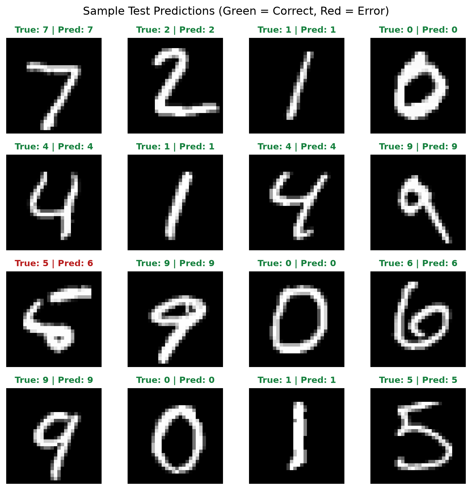
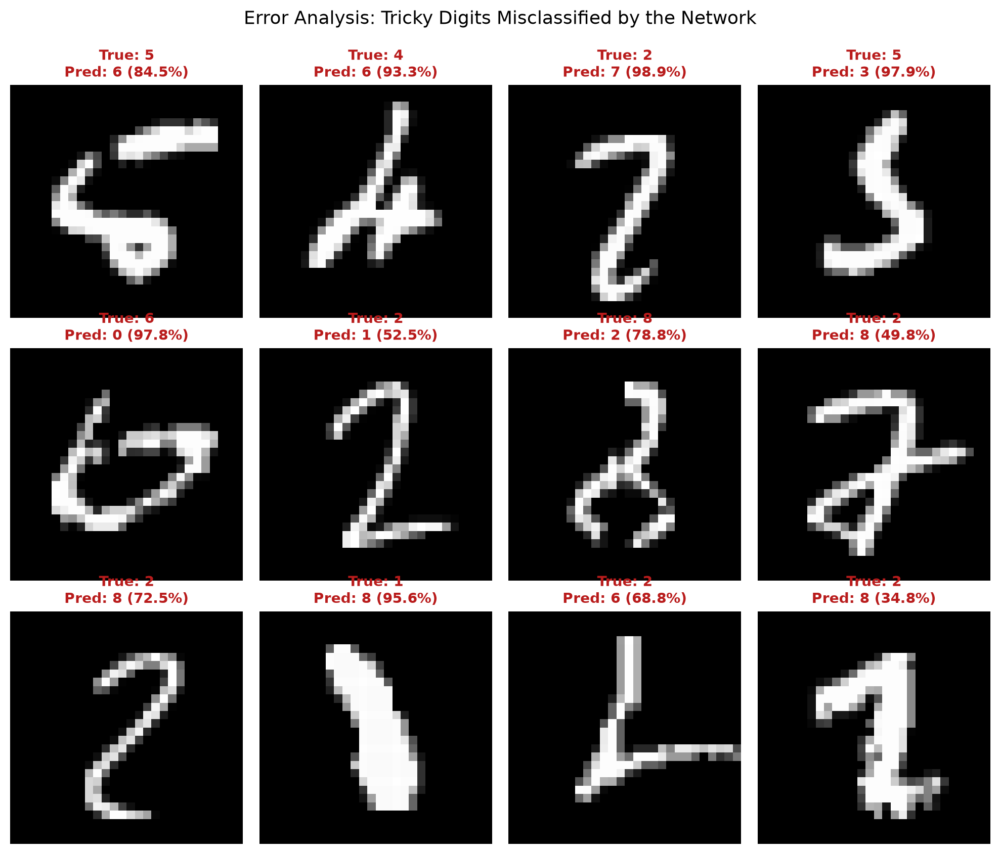

# Neural Networks from Scratch

[](https://www.python.org/)
[](https://opensource.org/licenses/MIT)
[](https://numpy.org/)
[]()

> A chapter-by-chapter, textbook-style journey to learning deep learning from first principles.
> Each chapter is a self-contained module where we obtain a dataset, build the neural network from scratch in pure NumPy, train it, validate it, test on unseen data, and visualize the learning dynamics.

---

## Curriculum & Chapters

Click on any chapter to read the textbook explanation, inspect the code, run the notebook, and view output graphs:

| Chapter | Title & Focus | Architecture & Dataset | Status |
| :---: | :--- | :--- | :---: |
| **01** | [**Chapter 1: The First Neural Network (MNIST from Scratch)**](chapters/01-first-neural-network-mnist/) | **Dataset**: MNIST ($70,000$ digits)<br>**Model**: 2-layer MLP (784 $\to$ 128 ReLU $\to$ 10 Softmax)<br>**Optimization**: Mini-batch SGD + Momentum<br>**Test Accuracy**: **97.9%** | Completed |
| **02** | **Chapter 2: Optimization & Regularization (Adam, Dropout, BatchNorm)** | Deep MLPs, diagnosing overfitting, learning rate scheduling | *Upcoming* |
| **03** | **Chapter 3: Convolutional Neural Networks (CNNs from Scratch)** | 2D Convolutions, pooling, spatial invariance, image feature maps | *Upcoming* |
| **04** | **Chapter 4: Autograd Engine** | Building a micrograd-style reverse-mode automatic differentiation DAG | *Upcoming* |
| **05** | **Chapter 5: Sequence Models (RNNs & LSTMs)** | Hidden states, backpropagation through time, text generation | *Upcoming* |
| **06** | **Chapter 6: Attention & Transformers (Mini-GPT)** | Scaled dot-product attention, multi-head attention on Shakespeare | *Upcoming* |

---

## Chapter 1 Highlights

👉 **Read the full chapter textbook: [chapters/01-first-neural-network-mnist/README.md](chapters/01-first-neural-network-mnist/)**

```
INPUT LAYER               HIDDEN LAYER                OUTPUT LAYER
(784 Pixels)              (128 Neurons)               (10 Classes)

  [Pixel 1]   ──┐
  [Pixel 2]   ──┼───►  [ 128 Neurons ]  ───►  [ 10 Probabilities ]
     ...      ──┤         (with ReLU)               (with Softmax)
  [Pixel 784] ──┘
```

### Visual Outputs Generated in Chapter 1

| Learning Dynamics | Confusion Matrix |
| :---: | :---: |
|  |  |

| Sample Test Predictions | Error Analysis (Ambiguous Digits) |
| :---: | :---: |
|  |  |

---

## Repository Structure

```text
.
├── README.md                                  # Repository overview and chapter roadmap
├── pyproject.toml                             # Pinned dependencies & configuration
├── LICENSE                                    # MIT License
├── chapters/
│   └── 01-first-neural-network-mnist/         # Chapter 1 folder
│       ├── README.md                          # Chapter textbook guide & concepts
│       ├── notebook.ipynb                     # Interactive runnable Jupyter walkthrough
│       ├── train.py                           # Training, validation & testing script
│       └── plots/                             # Generated high-resolution output charts
│           ├── sample_digits.png
│           ├── loss_accuracy_curves.png
│           ├── confusion_matrix.png
│           ├── test_predictions.png
│           └── misclassified_examples.png
├── src/                                       # Core neural network toolkit
│   ├── __init__.py
│   ├── dataset.py                             # MNIST download, parse, normalize, batching
│   ├── model.py                               # NeuralNetwork, ReLU, Softmax, Backprop
│   └── visualize.py                           # Matplotlib charting utilities
└── tests/
    └── test_model.py                          # Finite-difference gradient checks & shapes
```

---

## Quickstart

### 1. Clone & Set Up Environment

```bash
git clone https://github.com/Soorya-Narayan/Neural-networks-from-scratch.git
cd Neural-networks-from-scratch

# Create and activate virtual environment
python3 -m venv .venv
source .venv/bin/activate

# Install dependencies (NumPy, Matplotlib, PyTorch, JupyterLab, PyTest)
pip install -e ".[dev]"
```

### 2. Run Chapter 1

```bash
# Run Chapter 1 end-to-end training (takes ~2.3 seconds)
python chapters/01-first-neural-network-mnist/train.py
```

### 3. Run the Unit Tests

```bash
# Verify analytical backprop gradients against finite-difference numerical gradients
pytest
```

### 4. Open the Interactive Notebook

```bash
jupyter lab chapters/01-first-neural-network-mnist/notebook.ipynb
```

---

## License

This project is licensed under the [MIT License](LICENSE).
