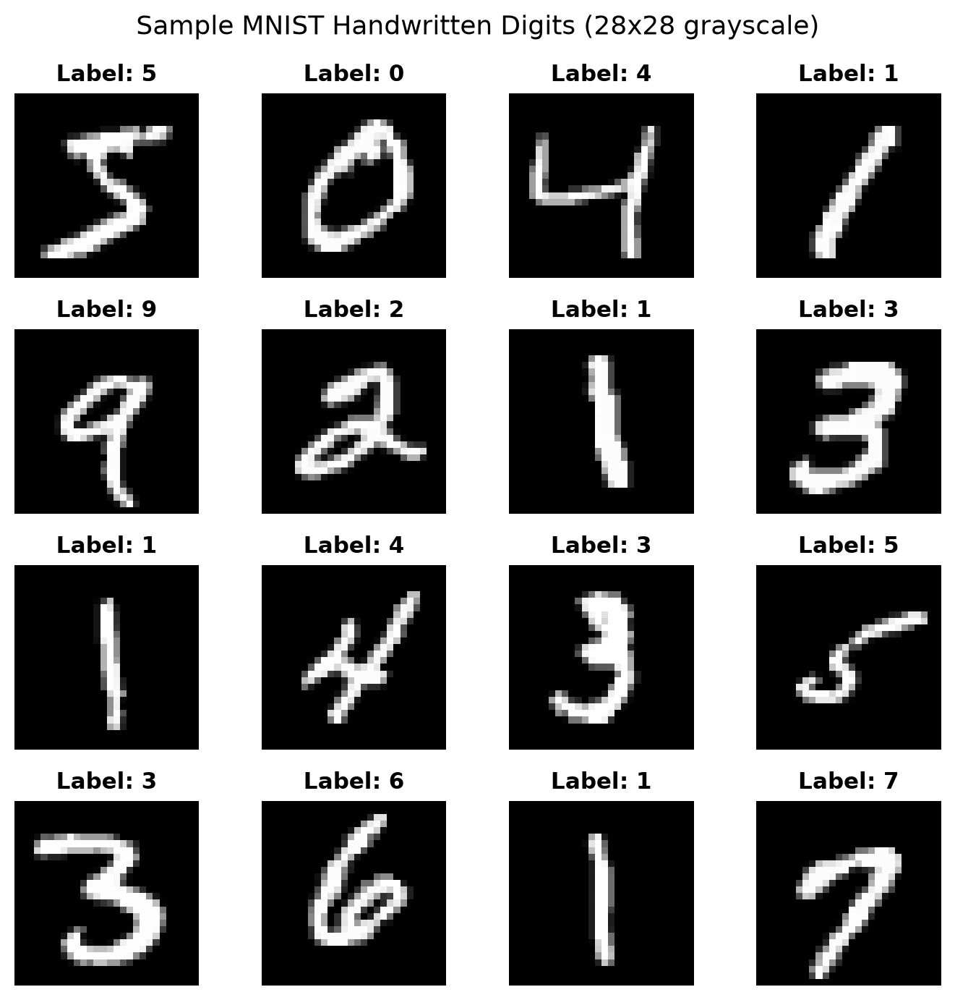

# Chapter 1: Building Your First Neural Network (MNIST from Scratch)

[-orange.svg)](http://yann.lecun.com/exdb/mnist/)
[]()
[](https://numpy.org/)

> **Welcome to Chapter 1!**
> This textbook chapter is written for anyone curious about how machine learning actually works under the hood. No prior deep learning knowledge is assumed.
>
> We will build a complete artificial neural network **from scratch in pure NumPy** — no PyTorch, no TensorFlow, no black-box magic. Every equation, forward pass, activation function, and calculus gradient is written by hand.

---

## The Hook: How Does a Postal Machine Read a Messy ZIP Code?

Imagine you are standing in a postal sorting facility in 1989. Every night, millions of letters arrive with handwritten postal codes scribbled on the envelopes. Some numbers are drawn with fountain pens, some with messy pencils, some slanted wildly, some with disconnected loops.

```
How people write the number "7":
  ┌───┐      ╱───┐      ┌───┐      ───┬───
  │   │          │        ──┼──       │   
      │          │          │         │   
```

If you were a traditional software engineer, how would you write a computer program to detect a `7`?
* You might try writing rules: `"If there is a horizontal stroke on top, and a diagonal stroke going down to the left, it's a 7."`
* But what if someone crosses the middle of their `7`? Does that make it a `+`?
* What if the top stroke is curved? Does it become a `1` or a `2`?

**Traditional rule-based programming fails completely on messy human data.** There are simply too many edge cases to ever write down by hand.

### The Paradigm Shift: Machine Learning
Instead of writing millions of fragile rules, we take a radically different approach:
1. We collect **70,000 real handwritten digits** written by real people.
2. We build a network of simple mathematical calculation units (**artificial neurons**).
3. We show the images to the network one by one.
4. Whenever it guesses wrong, we nudge its internal dials slightly so that it makes a better guess next time.
5. After seeing enough examples, the machine **discovers the rules of handwriting on its own**.

---

## Files in this Chapter

* **[notebook.ipynb](notebook.ipynb)**: Interactive step-by-step Jupyter notebook where you can run the code interactively.
* **[train.py](train.py)**: Runnable standalone script that downloads the dataset, trains the model, and evaluates test performance.
* **[plots/](plots/)**: Visualizations generated during training:
  * [`plots/sample_digits.png`](plots/sample_digits.png) — Sample raw digit images from the dataset.
  * [`plots/loss_accuracy_curves.png`](plots/loss_accuracy_curves.png) — The network learning over 10 epochs.
  * [`plots/confusion_matrix.png`](plots/confusion_matrix.png) — Heatmap showing which digits are easiest or hardest to classify.
  * [`plots/test_predictions.png`](plots/test_predictions.png) — Model predictions on real test images (green = correct, red = error).
  * [`plots/misclassified_examples.png`](plots/misclassified_examples.png) — In-depth look at tricky handwriting that fooled the network.

---

## 1. Fundamentals: The Core Concepts Explained Simply

Before writing code or math, let us build intuition for every term you will encounter.

### A. The Dataset (MNIST)
* **What is MNIST?** Modified National Institute of Standards and Technology dataset. It is the classic "Hello World" of machine vision: 70,000 small grayscale images of digits ($0$ through $9$).
* **What is a Pixel?** Every image is a grid of 28 squares tall by 28 squares wide ($28 \times 28 = 784$ total pixels). To a computer, a pixel is just a single brightness number from `0` (pitch black background) to `255` (bright white ink).
* **Normalization (Why divide by 255?)**: Computers struggle with numbers that are wildly different in scale. Dividing each pixel by `255.0` squashes all pixel values into a neat range between `0.0` (black) and `1.0` (white).
* **Flattening**: Our first neural layer expects a flat list of numbers rather than a 2D square. We unroll the $28 \times 28$ grid into a single row of $784$ numbers.



---

### B. The Three Splits: Why We Never Test on Training Data
Imagine a teacher preparing students for a final exam:
1. **Training Set (50,000 images) — The Homework**: The textbook exercises the network practices on over and over. It is allowed to check its mistakes and adjust its dials.
2. **Validation Set (10,000 images) — The Weekly Pop Quiz**: Taken after each practice round. The network is *not* allowed to adjust its dials based on this quiz. We use it to ensure the network is actually understanding patterns rather than merely memorizing answers.
3. **Test Set (10,000 images) — The Final Exam**: Strictly locked in a safe until training is completely finished. It provides the definitive score on how well the model handles genuine real-world handwriting.

---

### C. The Artificial Neuron: A Dimmer Switch for Features

In human biology, a brain cell receives electrical impulses through dendrites, processes them, and decides whether to send a signal down its axon. 
An **artificial neuron** is simply the mathematical equivalent of this process:

```
Inputs (784 Pixels)         Weights (Volume Dials)
   x₁ (Pixel 1)   ──────► [ w₁ ] ──────┐
   x₂ (Pixel 2)   ──────► [ w₂ ] ──────┼──► [ Sum: z = w·x + b ] ──► [ Activation: ReLU ] ──► Output (a)
        ...                            │           ▲
   x₇₈₄ (Pixel 784) ────► [ w₇₈₄ ] ────┘           │
                                                Bias (b)
```

1. **Inputs ($x$)**: The brightness values of the 784 pixels.
2. **Weights ($w$)**: Think of these as **volume knobs** on each connection:
   * A **positive weight** means: *"If this pixel is lit, it strongly suggests this digit!"* (e.g. a vertical line of pixels in the center suggests a `1`).
   * A **negative weight** means: *"If this pixel is lit, it is definitely NOT this digit!"* (e.g. ink in the center rules out a `0`).
3. **Bias ($b$)**: Think of this as the neuron's **hair-trigger threshold**. Even if all inputs are zero, how eager is this neuron to turn on?
4. **Weighted Sum ($z$)**: We multiply each pixel by its dial, sum them all up, and add the bias:
   $$z = \sum_{i=1}^{784} x_i w_i + b = (x_1 w_1 + x_2 w_2 + \dots + x_{784} w_{784}) + b$$

---

### D. Why We Need Non-Linearity (The Origami Metaphor)

If all a neuron does is multiply and add ($z = w \cdot x + b$), it is purely **linear** (a straight line or flat sheet).
If you chain 100 purely linear layers together, the mathematical result is still just one single flat equation:
$$\text{Linear}(\text{Linear}(x)) = \text{Still Linear}$$

Real handwriting is not made of straight linear cuts; it is made of loops, curves, and corners. 
To carve out complex decision shapes, we must introduce **non-linear activation functions**:

#### 1. Hidden Layer: ReLU (Rectified Linear Unit)
* **The Rule**: If the weighted sum is negative, output 0. If positive, let the number pass straight through!
  $$\text{ReLU}(z) = \max(0, z)$$
* **Intuition**: Like a diode in electronics or a biological neuron's threshold — it only fires when the evidence crosses zero.
* **Why it's popular**: It is lightning-fast to compute (`np.maximum(0, z)`) and avoids the notorious vanishing gradient problem.

#### 2. Output Layer: Softmax (The Betting Pool)
The final layer has 10 neurons (one for each digit from 0 to 9). Their raw sums ($z$) might be unpredictable numbers like `[2.1, -0.8, 8.4, 0.1, ...]`.
How do we convert these arbitrary numbers into meaningful probabilities?
We use the **Softmax** function:
$$\text{Softmax}(z_i) = \frac{e^{z_i}}{\sum_{j=0}^{9} e^{z_j}}$$

* Softmax turns all numbers positive (using exponential $e^z$) and normalizes them so their sum equals exactly **1.0 (100%)**.
* Now the network can report confidence: *"I am 96.2% sure this is a 2, 3.1% sure it's a 7, and 0.7% sure it's something else."*

---

### E. How The Machine Learns: The Loop of Life

```
┌────────────────────────────────────────────────────────┐
│ 1. Forward Pass: Make a guess based on current dials   │
└──────────────────────────┬─────────────────────────────┘
                           ▼
┌────────────────────────────────────────────────────────┐
│ 2. Loss Function: Measure how bad the guess was        │
└──────────────────────────┬─────────────────────────────┘
                           ▼
┌────────────────────────────────────────────────────────┐
│ 3. Backpropagation: Trace back who is to blame         │
└──────────────────────────┬─────────────────────────────┘
                           ▼
┌────────────────────────────────────────────────────────┐
│ 4. Optimizer: Nudge every dial in the right direction  │
└────────────────────────────────────────────────────────┘
```

#### 1. The Loss Function (Categorical Cross-Entropy)
The loss is our scoring penalty:
$$L = -\sum_{i=0}^{9} y_i \log(\hat{y}_i) = -\log(\hat{y}_{\text{correct}})$$
* If the true digit is `7` and the network gave `7` a 99% probability: $L = -\log(0.99) \approx 0.01$ (Tiny penalty!).
* If the network gave `7` only a 1% probability: $L = -\log(0.01) \approx 4.60$ (Huge penalty!).

#### 2. The Backward Pass (Backpropagation & Calculus Chain Rule)
Backpropagation is the mathematical way of assigning blame:
* Starting at the error in the output, we walk backwards through the network layer by layer.
* Using the calculus chain rule ($\frac{\partial L}{\partial W} = \frac{\partial L}{\partial A} \cdot \frac{\partial A}{\partial Z} \cdot \frac{\partial Z}{\partial W}$), we calculate the exact derivative (gradient) for each of our 101,770 weights.
* The gradient tells us: *"If you increase this specific weight by a tiny fraction, will the error go up or down?"*

#### 3. Mini-Batch Gradient Descent with Momentum
* **Learning Rate ($\alpha = 0.05$)**: The size of the step we take in the direction that reduces error. If too large, the network overshoots and diverges; if too small, training crawls.
* **Mini-Batches (size = 64)**: Rather than calculating gradients for all 50,000 images at once (slow) or after single images (too noisy), we update the dials after small batches of 64 images.
* **Momentum ($\mu = 0.9$)**: Imagine rolling a heavy bowling ball down a bumpy slope. Instead of getting stuck in every small divot, the ball accumulates momentum along the main downward path:
  $$v_t = \mu \cdot v_{t-1} + \alpha \cdot \nabla_W L, \quad W \leftarrow W - v_t$$

---

## 2. Our Network Architecture

We construct a 2-layer Multi-Layer Perceptron (MLP):

```
INPUT LAYER (784)             HIDDEN LAYER (128)           OUTPUT LAYER (10)
784 Normalized Pixels        128 Feature Detectors         10 Class Probabilities
  ┌───────────────┐            ┌───────────────┐             ┌───────────────┐
  │ [Pixel 1]     │───┐        │ [Neuron 1]    │───┐         │ [Digit 0]     │
  │ [Pixel 2]     │───┼───────►│ [Neuron 2]    │───┼────────►│ [Digit 1]     │
  │     ...       │───┤        │     ...       │───┤         │     ...       │
  │ [Pixel 784]   │───┘        │ [Neuron 128]  │───┘         │ [Digit 9]     │
  └───────────────┘            └───────────────┘             └───────────────┘
                                  (with ReLU)                   (with Softmax)
```

### Parameter Breakdown
* **Layer 1 Weights ($W_1$)**: Matrix of shape $(784, 128) = 100,352$ parameters.
* **Layer 1 Biases ($b_1$)**: Vector of shape $(1, 128) = 128$ parameters.
* **Layer 2 Weights ($W_2$)**: Matrix of shape $(128, 10) = 1,280$ parameters.
* **Layer 2 Biases ($b_2$)**: Vector of shape $(1, 10) = 10$ parameters.
* **Total Trainable Parameters**: **101,770 dials**.

---

## 3. Results & Visual Diagnostic Analysis

We train the model for 10 epochs (~2.3 seconds total run time on standard CPU).

### A. Learning Dynamics Over Time


* **Rapid Initial Learning**: Within the first 2 epochs, training and validation accuracy shoot past 93%. The network quickly discovers broad rules (e.g. "a vertical line is usually a 1", "two stacked circles is an 8").
* **No Overfitting**: Notice how the validation curve (green) stays tightly bound to the training curve (blue). The model does not memorize individual pixels; it learns generalizable features.

---

### B. The Final Exam: 10,000 Unseen Test Images

When tested on the strictly isolated test dataset:
* **Final Test Accuracy**: **97.67%** (only 233 mistakes out of 10,000 images).
* **Final Test Loss**: **0.0831**

---

### C. The Confusion Matrix: Where Does the Network Slip Up?

A confusion matrix compares what the digit *actually was* (rows) against what the network *predicted* (columns):


* The glowing diagonal line indicates massive correct predictions for all 10 digits.
* Off-diagonal entries show rare, understandable mistakes:
  * A few `4`s were mistaken for `9`s (if the top of the 4 is nearly closed).
  * A few `7`s were mistaken for `2`s (if the 7 has a prominent base stroke).
  * A few `5`s were mistaken for `3`s (if the top bar of the 5 is curved).

---

### D. Visual Predictions & Tricky Error Analysis


Looking at the rare cases where the network failed reveals something fascinating:


Many of these mistakes are handwritten digits so distorted, faded, or ambiguous that even human observers would disagree on what digit was intended!

---

## 4. How to Run This Chapter Yourself

From your terminal in the repository root:

```bash
# 1. Run the Chapter 1 training pipeline directly
python chapters/01-first-neural-network-mnist/train.py

# 2. Run the automated unit tests verifying math and gradients
pytest tests/test_model.py

# 3. Launch the interactive Jupyter notebook
jupyter lab chapters/01-first-neural-network-mnist/notebook.ipynb
```
