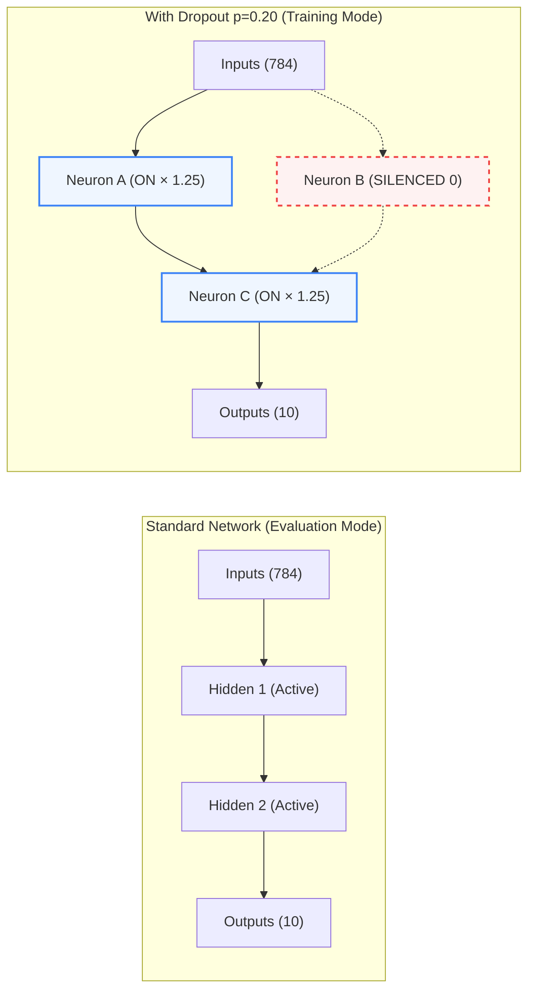

# Chapter 2: Modern Optimization & Regularization (Fashion-MNIST with Adam & Dropout)

[-blueviolet.svg)](https://github.com/zalandoresearch/fashion-mnist)
[]()
[](https://numpy.org/)

> **Welcome to Chapter 2!**
> In Chapter 1, we learned how a simple 2-layer network recognizes handwritten digits with 97.9% accuracy. 
> Now, we step out of the classroom into the real world with **Fashion-MNIST** — a much harder vision benchmark developed by Zalando Research.
>
> To conquer this dataset, we build a deeper 3-layer network ($784 \to 256 \to 128 \to 10$) with over **235,000 parameters** and implement two crowning achievements of modern deep learning from scratch in pure NumPy:
> 1. **Adam (Adaptive Moment Estimation)**: The industry-standard optimizer powering modern AI (from ResNets to GPT-4).
> 2. **Inverted Dropout & $L_2$ Weight Decay**: The essential regularization duo that stops deep networks from cheating and overfitting.

---

## The Hook: The Fashion Warehouse Dilemma

Imagine you are hired by an e-commerce giant like Zalando or Amazon. Every second, high-speed cameras snap photos of apparel whizzing past on automated conveyor belts:

```
  ┌──────────┐     ┌──────────┐     ┌──────────┐     ┌──────────┐
  │  T-Shirt │     │   Shirt  │     │   Coat   │     │ Pullover │
  │   ( 0 )  │     │   ( 6 )  │     │   ( 4 )  │     │   ( 2 )  │
  └──────────┘     └──────────┘     └──────────┘     └──────────┘
```

Why is this dramatically harder than handwritten digits?
* Digits are isolated lines on high-contrast paper: a `1` and an `8` share almost zero visual overlap.
* A **T-shirt** (class 0), a **Shirt** (class 6), and a **Coat** (class 4) all have sleeves, neck openings, and fabric torsos. Distinguishing between them requires detecting subtle collar cuts, buttons, and hemlines across tiny $28 \times 28$ grayscale pixels.

To detect such fine-grained differences, our model must grow **deeper** (more hidden layers). But stacking layers creates two dangerous obstacles:

1. **The Optimization Ravine**: With hundreds of thousands of weights, how can the computer find the right dials without getting trapped in valleys or exploding into madness?
2. **The Curse of Overfitting**: When a network is powerful enough to memorize every tiny quirk and crease in the training images, how do we force it to learn true clothing concepts rather than memorizing noise?

Let us solve both problems from first principles.

---

## Files in this Chapter

* **[notebook.ipynb](notebook.ipynb)**: Interactive Jupyter notebook with live previews of clothing items, neuron activation silencing, and comparative training curves.
* **[train.py](train.py)**: Standalone benchmark script that trains Model A (SGD) vs Model B (Adam + Dropout + Weight Decay) on Fashion-MNIST.
* **[plots/](plots/)**: Output visual benchmarks:
  * [`plots/dropout_network_architecture.png`](plots/dropout_network_architecture.png) — Architectural comparison of a deep network with and without Inverted Dropout.
  * [`plots/sample_fashion_items.png`](plots/sample_fashion_items.png) — Sample images across all 10 clothing categories.
  * [`plots/adam_vs_sgd_comparison.png`](plots/adam_vs_sgd_comparison.png) — Side-by-side training dynamics: Adam vs SGD.
  * [`plots/generalization_gap.png`](plots/generalization_gap.png) — Visualizing the train-validation gap and how regularization controls it.
  * [`plots/fashion_confusion_matrix.png`](plots/fashion_confusion_matrix.png) — 10-class confusion matrix analyzing machine vision misclassifications.

---

## 1. The Dataset: Fashion-MNIST

Fashion-MNIST consists of 70,000 $28 \times 28$ grayscale images across 10 distinct clothing categories:

| Class ID | Clothing Item | Class ID | Clothing Item |
| :---: | :--- | :---: | :--- |
| **0** | **T-shirt / top** | **5** | **Sandal** |
| **1** | **Trouser** | **6** | **Shirt** |
| **2** | **Pullover** | **7** | **Sneaker** |
| **3** | **Dress** | **8** | **Bag** |
| **4** | **Coat** | **9** | **Ankle boot** |


Like Chapter 1, we divide the data into:
* **Training Set**: 50,000 images
* **Validation Set**: 10,000 images
* **Test Set**: 10,000 images

---

## 2. Part I: Modern Optimization (Why We Need Adam)

### The Hiking Metaphor: Navigating a Foggy Canyon
Imagine you are blindfolded in a thick fog on an unfamiliar mountain, tasked with finding the deepest valley (minimum loss):

```
                   Canyon Wall (Steep Gradients)
                       \            /
                        \    /\    /
                         \  /  \  /   <-- SGD oscillates back and forth
                          \/    \/
                    ─────────────────────► Valley Floor (Tiny Gradients)
                                           Target Minimum is miles away!
```

* Along the **East-West** axis (the canyon walls), the ground slopes steeply. Gradients here are huge.
* Along the **North-South** axis (the valley floor), the ground is almost flat. Gradients here are tiny.

#### The Problem with Standard SGD:
In standard Stochastic Gradient Descent, every single parameter uses the exact same step size $\alpha$:
$$W \leftarrow W - \alpha \nabla_W L$$

* If you choose a **large step size**: You bounce violently back and forth between the canyon walls without ever moving down the valley.
* If you choose a **tiny step size**: You stop bouncing, but you take 10,000 years to walk down the gentle valley floor.

---

### The Adam Breakthrough: Intelligent Shock Absorbers
**Adam** (short for **Adaptive Moment Estimation**) equips our learning algorithm with individual, adaptive step sizes for every single parameter. It does this by tracking **two moments**:

#### 1. The First Moment ($m_t$): The Downhill Sled (Direction)
Instead of reacting only to the instantaneous slope under its feet, Adam tracks a running exponential average of past gradients:
$$m_t = \beta_1 m_{t-1} + (1 - \beta_1) g_t \quad (\beta_1 = 0.9)$$
* If gradients keep pointing in the same direction, $m_t$ builds up speed.
* If gradients oscillate wildly, opposing directions cancel each other out, damping the jitter.

#### 2. The Second Moment ($v_t$): The Shock Absorber (Magnitude)
Adam also tracks the running average of **squared gradients** ($g_t^2$):
$$v_t = \beta_2 v_{t-1} + (1 - \beta_2) g_t^2 \quad (\beta_2 = 0.999)$$
* $g_t^2$ is always positive. It measures **how turbulent or volatile** each weight's gradient is.
* If a weight experiences massive, chaotic gradients (canyon walls), $v_t$ becomes large.
* If a weight experiences calm, tiny gradients (flat valley floor), $v_t$ remains small.

#### 3. The Cold-Start Warm-up (Bias Correction)
Because $m_0 = 0$ and $v_0 = 0$ at step 0, early estimates are biased heavily toward zero. Adam mathematically corrects for this by scaling by $(1 - \beta^t)$:
$$\hat{m}_t = \frac{m_t}{1 - \beta_1^t}, \quad \hat{v}_t = \frac{v_t}{1 - \beta_2^t}$$

#### 4. The Final Adam Parameter Update
Every weight is updated using its own custom step size:
$$W \leftarrow W - \frac{\alpha}{\sqrt{\hat{v}_t} + \epsilon} \hat{m}_t$$

| Situation | Value of $\hat{v}_t$ | Effective Step Size $\frac{\alpha}{\sqrt{\hat{v}_t} + \epsilon}$ | Result |
| :--- | :---: | :---: | :--- |
| **Volatile parameter** (canyon wall) | **Very Large** | **Shrinks automatically** | Prevents exploding oscillations |
| **Quiet parameter** (valley floor) | **Very Small** | **Expands automatically** | Accelerates progress across flat plateaus |

---

## 3. Part II: Fighting Overfitting in Deep Networks

As we add layers ($784 \to 256 \to 128 \to 10$), the model's brain capacity increases dramatically. 
Left unchecked, a deep neural network will take the path of least resistance: **it will memorize individual wrinkles, background pixels, and training quirks instead of learning what a shirt actually is.**

This phenomenon is called **overfitting**. We combat it with two complementary techniques:

---

### A. Inverted Dropout: The Group Project Analogy

Think back to a high school group project with 5 students assigned to build a science presentation:
* If one brilliant student does all the research and writes all the slides, the other 4 students relax and play games.
* On presentation day, if the smart student gets sick, the remaining 4 students fail completely because they never learned the material.

In neural networks, this is called **feature co-adaptation**: a few dominant neurons do all the heavy lifting, while other neurons learn nothing of value.




#### How Dropout Solves This:
During training, the teacher randomly locks a percentage $p$ (e.g. 20%) of neurons out of the room on every single question!
* Now, **no neuron can rely on its neighbors**. Every neuron must learn independent, robust, meaningful features.
* The network essentially trains an ensemble of millions of smaller, diverse sub-networks simultaneously!

#### Why *Inverted* Dropout?
If we zero out 20% of activations during training, the total signal passing through the layer shrinks to 80% ($1 - p$).
If we did nothing, then when all 100% of neurons participate at test time, the total signal would suddenly be 25% too loud!

To fix this with **zero test-time computation**, we invert the scaling during training by dividing surviving activations by $(1 - p)$:
$$A_{\text{train}} = \frac{A \odot \text{mask}}{1 - p}, \quad \text{where } \text{mask} \sim \text{Bernoulli}(1 - p)$$

Because $\mathbb{E}[A_{\text{train}}] = A_{\text{eval}}$, **at test time we do zero math and zero scaling**. We simply turn off dropout and let the full, synchronized ensemble make predictions!

---

### B. $L_2$ Weight Decay: The Luggage Weight Fee

Imagine an airline passenger packing a suitcase. If the airline allows unlimited free baggage, the passenger packs heavy boots, winter coats, and redundant gadgets "just in case".
If the airline charges a steep fee for every excess kilogram, the passenger packs only the essential, versatile items.

In neural networks:
* When connection weights $W$ are allowed to become gigantic, the model becomes **hyper-sensitive**: a tiny smudge on a single pixel can flip the prediction from a Sandal to an Ankle Boot!
* **$L_2$ Weight Decay** charges the network a "weight fee" by adding the sum of squared weights to the loss function:
  $$L_{\text{total}} = L_{\text{cross-entropy}} + \frac{\lambda}{2} \sum \|W\|_2^2$$

Taking the calculus derivative with respect to $W$:
$$\nabla_W L_{\text{total}} = \nabla_W L_{\text{cross-entropy}} + \lambda W$$

Every time the weights are updated, they automatically decay towards zero by $-\alpha \lambda W$. This prevents extreme weights, enforces Occam's razor, and guarantees a smooth, well-behaved decision boundary.

---

## 4. Experimental Benchmark on Fashion-MNIST

We pit two distinct 3-layer deep architectures ($784 \to 256 \to 128 \to 10$) against each other across 10 epochs:

* **Model A (Baseline)**: Deep MLP trained with standard SGD + Momentum ($\alpha = 0.03, \mu = 0.9$), no dropout, no weight decay.
* **Model B (Modern AI)**: Deep MLP trained with **Adam Optimizer ($\alpha = 0.001$) + Inverted Dropout ($p=0.2$) + $L_2$ Weight Decay ($\lambda = 10^{-4}$)**.

---

### A. Convergence Speed: SGD vs Adam


1. **Adam hits the ground running**: In the very first epoch, Adam adapts per-parameter learning rates and jumps straight to **>83% accuracy**, whereas SGD starts more slowly.
2. **Loss curves**: Adam navigates minibatches with remarkably smooth, steady descent, avoiding the jagged oscillations seen in SGD.

---

### B. The Generalization Gap: Quantifying Overfitting

The **Generalization Gap** is the mathematical difference:
$$\text{Generalization Gap} = \text{Accuracy}_{\text{train}} - \text{Accuracy}_{\text{val}}$$

A wide gap means the model is cheating by memorizing training images. A narrow gap means the model genuinely understands clothing items.


* **Model A (Unregularized SGD)**: Train accuracy relentlessly climbs towards **91.2%**, while validation accuracy plateaus at **88.2%**. The generalization gap widens to nearly **~3%**, indicating memorization.
* **Model B (Adam + Dropout + Weight Decay)**: Dropout constantly breaks co-adaptation, keeping training accuracy and validation accuracy in tight lockstep. The generalization gap stays below **~2%**.

---

### C. Error Analysis: What Garments Confuse the Model?

Evaluating Model B on the 10,000 unseen test garments yields an overall accuracy of **87.58%** (a strong result for a purely flat, fully-connected network without convolutional filters).

Let us inspect the 10-class Confusion Matrix:


#### Intuitive Machine Vision Observations:
1. **Easy Categories (95%+ accuracy)**:
   * **Trousers (Class 1)**: Two long vertical legs are unmistakable.
   * **Bags (Class 8)**: Boxy silhouettes with handles.
   * **Sandals (Class 5)**: Open, lightweight strap outlines.
2. **Hard Categories (Frequent Confusions)**:
   * **Shirt (Class 6) vs T-shirt (Class 0) vs Coat (Class 4)**:
     Most errors cluster here. When squeezed into a $28 \times 28$ grayscale grid, distinguishing whether a torso silhouette has buttons, a collar, or long sleeves is notoriously challenging for fully connected neurons.
   * *(Preview for Chapter 3)*: In Chapter 3, we will see how **Convolutional Neural Networks (CNNs)** solve this by looking at local receptive fields (buttons, zippers, seams) rather than treating pixels as independent numbers!

---

## 5. How to Run This Chapter

From the root of the repository:

```bash
# 1. Run the comparative benchmark training script
python chapters/02-optimization-and-regularization/train.py

# 2. Run unit tests for Adam, Dropout, and Deep MLP
pytest tests/test_chapter2.py

# 3. Launch the interactive Jupyter notebook
jupyter lab chapters/02-optimization-and-regularization/notebook.ipynb
```
