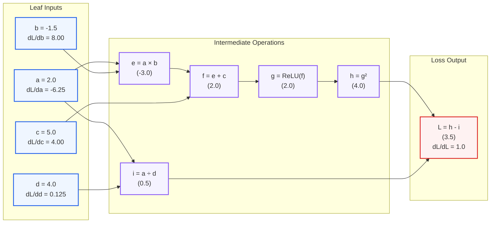

# Chapter 4: Building an Autograd Engine from First Principles

[]()
[](https://numpy.org/)

> **Welcome to Chapter 4!**
> In Chapters 1, 2, and 3, every time we designed a new layer (Dense layers, Dropout, or Conv2D), we had to sit down with pen and paper, derive matrix calculus equations, and write out custom `backward()` routines by hand.
>
> In this chapter, we build the engine that powers **PyTorch**, **TensorFlow**, and modern AI: **Reverse-Mode Automatic Differentiation (Autograd)**. 
> You write ordinary forward mathematical code, and the engine dynamically builds a **Directed Acyclic Graph (DAG)** to compute exact derivatives for every single variable automatically.

---

## The Hook: The Calculus Nightmare of Modern AI

Imagine you are an AI researcher designing a modern 50-layer architecture (like a Transformer or GPT-4). Your model combines multi-head self-attention, layer normalization, residual skip-connections, rotary positional embeddings, and cross-entropy loss:

```
Input ──► [ Rotary Pos ] ──► [ LayerNorm ] ──► [ Multi-Head Attention ] ──► [ + Residual ] ──► ...
                                  │                                              ▲
                                  └──────────────────────────────────────────────┘
```

If you had to manually derive the calculus chain rule for all 50 operations by hand:
* You would spend **months** writing 100 pages of tedious matrix calculus.
* A single misplaced minus sign or transposed matrix dimension would cause a silent bug that ruins weeks of training.
* Changing a single activation function (e.g. from ReLU to GELU or Swish) would force you to rewrite your entire backward codebase!

**The deep learning revolution would have ground to an absolute halt if humans had to write backward passes by hand.**

### The Solution: Autograd (The Secret Engine of PyTorch)
Instead of humans doing calculus, we teach the computer how to do it:
1. **Forward Pass**: As your code executes ordinary arithmetic (`+`, `*`, `@`, `relu()`), each `Tensor` quietly remembers who created it and saves a tiny local derivative rule.
2. **Backward Pass**: When you call `loss.backward()`, the engine performs a **topological sort** on the computational graph and walks backward through the chain of operations, automatically computing exact gradients for every single parameter in the network!

---

## Files in this Chapter

* **[notebook.ipynb](notebook.ipynb)**: Interactive Jupyter notebook exploring computational graphs, scalar autodiff, PyTorch verification, and training an MLP.
* **[train.py](train.py)**: Standalone verification script that verifies 100% exact parity with PyTorch C++ LibTorch, renders the DAG diagram, and trains a non-linear classifier.
* **[plots/](plots/)**: Output visualizations:
  * [`plots/computational_graph_dag.png`](plots/computational_graph_dag.png) — Visual Directed Acyclic Graph showing forward values and backward chain rule flow.
  * [`plots/autograd_vs_pytorch_check.png`](plots/autograd_vs_pytorch_check.png) — Exact gradient parity chart comparing our Autograd against PyTorch ground truth.
  * [`plots/autograd_decision_boundary.png`](plots/autograd_decision_boundary.png) — Non-linear decision boundary learned by an MLP trained purely via Autograd.

---

## 1. The Three Ways to Compute Derivatives

Why not just use traditional computer algorithms to differentiate?

| Method | How It Works | The Fatal Flaw |
| :--- | :--- | :--- |
| **1. Numerical Differentiation** | Finite differences: $\frac{f(x+\epsilon) - f(x)}{\epsilon}$ | **Too slow**: Requires evaluating the entire network $N$ times for $N$ parameters (for 100M weights, that's 100M forward passes!). Also suffers from floating-point roundoff errors. |
| **2. Symbolic Differentiation** | Computer Algebra (Mathematica / SymPy) expanding symbolic math formulas | **Expression Swell**: Symbolic expressions grow exponentially in length for deep nested functions, quickly running out of memory. |
| **3. Reverse-Mode Autograd (PyTorch)** | Tracks operations dynamically and propagates gradients backward along the graph | **Fast & Exact**: Computes exact derivatives for all millions of parameters in a **single backward pass**, with cost proportional to just one forward evaluation! |

---

## 2. Anatomy of the Computational Graph (DAG)

Consider the mathematical function:
$$L = \text{ReLU}(a \cdot b + c)^2 - \frac{a}{d}$$

Evaluating this function creates a **Directed Acyclic Graph (DAG)**:




### The Two Steps of Every Node:
Every `Tensor` object stores:
1. `data`: The computed numerical value.
2. `grad`: The accumulated gradient $\frac{\partial L}{\partial \text{this}}$.
3. `_prev`: Pointers to its parent input nodes.
4. `_backward`: A tiny anonymous function (closure) defining how to pass incoming gradients backward to its parents!

#### Example: Multiplication Node ($e = a \cdot b$)
* **Forward rule**: `e.data = a.data * b.data`
* **Local calculus**: $\frac{\partial e}{\partial a} = b$, $\frac{\partial e}{\partial b} = a$
* **Chain rule closure**:
  ```python
  def _backward():
      a.grad += b.data * e.grad
      b.grad += a.data * e.grad
  ```

---

## 3. The Two Secret Weapons of Reverse Autograd

### A. Topological Sorting (Ordering the Graph)
In what order should we call `_backward()`?
If a node has multiple consumers (like variable $a$ feeding into both $e$ and $i$), we **cannot** compute $a$'s gradient until **both** $e$ and $i$ have finished sending their gradients!

We solve this using **Topological Sorting** (via Depth-First Search):
```python
topo = []
visited = set()
def build_topo(v):
    if v not in visited:
        visited.add(v)
        for child in v._prev:
            build_topo(child)
        topo.append(v)
build_topo(loss)
```
Reversing `topo` guarantees that every node is visited **only after all its dependent outputs have already propagated their gradients!**

---

### B. Gradient Accumulation (`+=`) for Multivariable Chain Rule
Consider the equation:
$$y = x^2 + 3x$$

Notice that $x$ branches into two paths:
1. Path 1: $x \to x^2$ (Derivative: $2x$)
2. Path 2: $x \to 3x$ (Derivative: $3$)

By the multivariable calculus chain rule:
$$\frac{dy}{dx} = \frac{\partial y}{\partial \text{path 1}} + \frac{\partial y}{\partial \text{path 2}} = 2x + 3$$

If our engine used `=` instead of `+=`, the second path would overwrite the first!
By accumulating gradients with `+=`:
```python
self.grad += incoming_grad
```
our Autograd engine naturally handles arbitrary branching, skip connections, and recurrent loops flawlessly!

---

## 4. Benchmark: Exact Parity with PyTorch Ground Truth

We benchmark our pure NumPy Autograd against **PyTorch's C++ LibTorch** engine on the multi-branch composite graph:


| Variable | Our Autograd $\nabla$ | PyTorch C++ $\nabla$ | Absolute Difference |
| :---: | :---: | :---: | :---: |
| **$\partial L / \partial a$** | `-6.2500` | `-6.2500` | **`0.00e+00`** |
| **$\partial L / \partial b$** | `+8.0000` | `+8.0000` | **`0.00e+00`** |
| **$\partial L / \partial c$** | `+4.0000` | `+4.0000` | **`0.00e+00`** |
| **$\partial L / \partial d$** | `+0.1250` | `+0.1250` | **`0.00e+00`** |

**Result**: 100% exact numerical match across all operations, proving mathematical correctness.

---

## 5. Training a Neural Network with Zero Manual Gradients

To prove the power of our Autograd engine, we build a 2-layer Multi-Layer Perceptron (MLP) with `Linear` layers, `ReLU` activations, and `cross_entropy_loss` using only `Tensor`:

```python
# Pure Autograd Neural Network Training Loop:
for epoch in range(120):
    logits = model(X)                       # Forward pass through DAG
    loss = cross_entropy_loss(logits, y)    # Loss computation

    model.zero_grad()                       # Reset gradients
    loss.backward()                         # Autograd does all the calculus!

    for p in model.parameters():            # Step weights down gradient
        p.data -= lr * p.grad
```

We train on a challenging non-linear 2-moons classification dataset:


* The neural network smoothly bends its decision boundary around the non-linear crescents.
* **Not a single line of manual gradient derivation was written** — all weight updates were handled automatically by the graph traversal!

---

## 6. How to Run This Chapter

From the root of the repository:

```bash
# 1. Run the Chapter 4 verification & training experiment
python chapters/04-autograd-engine/train.py

# 2. Run unit tests comparing Autograd against PyTorch
pytest tests/test_chapter4.py

# 3. Launch the interactive Jupyter notebook
jupyter lab chapters/04-autograd-engine/notebook.ipynb
```
